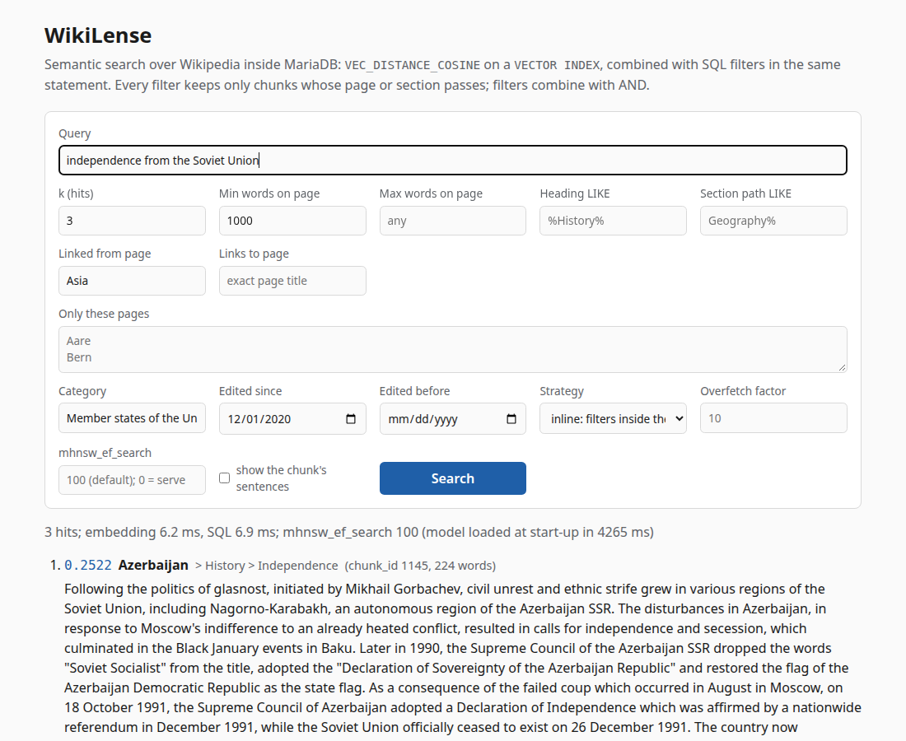

A project for area 4, "Vector search and RAG, natively" for the [MariaDB student database projects, 2026-09](https://mariadb.org/bachelor_hackathon_2026-09/).

# WikiLense

Semantic search over Wikipedia inside MariaDB, developed against **MariaDB 11.8.9**. Wikipedia
pages are cut into chunks, each chunk is embedded and stored in a `VECTOR(384)` column with a cosine
`VECTOR INDEX`, and a question is answered by one SQL statement: `ORDER BY VEC_DISTANCE_COSINE(...)`
together with ordinary predicates and joins. Claims of the FEVEROUS fact-verification benchmark are
the test queries and their gold evidence is the ground truth, so "it works well" is a number.

## Ask one question

```
git clone https://github.com/ylli-00/WikiLens.git && cd WikiLens
make setup
.venv/bin/wikilense query "Which river rises and ends entirely within Switzerland?" --k 1
```

```
 1. 0.3091  Aare  [chunk_id 1, 127 words]
    The Aare (German: [ˈaːrə]) or Aar (German: [aːɐ̯] (listen)) is a tributary of the High Rhine and
    the longest river that both rises and ends entirely within Switzerland. Its total length from
    its source to its junction with the Rhine comprises about 295 kilometres (183 mi), during which
    distance it descends 1,565 m (5,135 ft), draining an area of 17,779 km (6,865 sq mi), almost
    entirely within Switzerland, and accounting for close to half the area of the country, including
    all of Central Switzerland. There are more than 40 hydroelectric plants along the course of the
    Aare. The river's name dates to at least the La Tène period, and it is attested as Nantaror
    "Aare valley" in the Berne zinc tablet. The name was Latinized as Arula/Arola/Araris.
1 hit; model load 3533 ms, embedding 9.5 ms, SQL 5.5 ms (BAAI/bge-small-en-v1.5 on cpu, strategy inline, ef_search 100)
```

- That is the whole path. The output is copied from a run in a fresh clone, on a laptop whose GPU
  was not used ([results/fresh_clone_run.md](results/fresh_clone_run.md)).
- `make setup` needs Docker, Python 3.10 or newer and `make`. It starts MariaDB 11.8 in a container,
  builds a virtual environment and loads the 100 Wikipedia pages committed here
  ([the list](data/corpus/MANIFEST.md)). Nothing has to be edited. That run used `make setup CPU=1`,
  without the GPU packages, and took 4 minutes 41 seconds.
  [Setup and platforms](#setup-and-platforms) has the details, also for a Mac.
- Put your own question between the quotes. The first number is the cosine distance. `--k 5`
  returns more passages, `--explain` prints the SQL statement and MariaDB's plan, and `make serve`
  opens the same search as a web page at http://127.0.0.1:8000.
- [docs/EXAMPLES.md](docs/EXAMPLES.md) has the filtered queries, the hybrid with full-text search,
  every option, and ten statements for the `mariadb` client that need no Python.



## What we found

Every number comes from a file in [results/](results/) ([SUMMARY.md](results/SUMMARY.md) is the
overview, [docs/EVALUATION.md](docs/EVALUATION.md) the method), measured on the committed corpus.

> **The ground-truth set.** The brief asks for "a small ground-truth set — questions whose correct
> source article you already know". Ours is the 75 FEVEROUS claims whose gold evidence lies inside
> our 100 pages, selected by a fixed rule ([docs/DATA.md](docs/DATA.md)). Each claim is a statement
> to verify, not a question. For each one, annotators who searched all of Wikipedia marked the exact
> sentences that prove or refute it. So we know the correct source article *and* the correct
> sentences, and can measure evidence recall as well as article recall. We chose this over writing
> questions ourselves for two reasons. Questions written while reading an article reuse its words,
> which flatters recall. And the claims' labels (supported, refuted, not enough information) serve
> the planned LLM fact-checking extension.

| k | article recall | evidence recall | SQL p50 | SQL p95 |
|---|---|---|---|---|
| 1 | 63/75 (0.84) | 39/66 (0.59) | 0.50 ms | 0.86 ms |
| 5 | 74/75 (0.99) | 55/66 (0.83) | 0.45 ms | 0.79 ms |
| 10 | 74/75 (0.99) | 60/66 (0.91) | 0.51 ms | 0.94 ms |
| 20 | 74/75 (0.99) | 65/66 (0.99) | 0.64 ms | 1.10 ms |


- **Retrieval works and is fast.** The gold page of a claim is among the pages of the top 5 chunks
  for 74 of 75 claims. The complete gold evidence is inside the top 10 chunks for 60 of 66 claims
  and inside the top 20 for 65 of 66. The vector query takes 0.51 ms at the median for k=10.
  Embedding the query takes 4.6 ms on the GPU and 18 ms on the CPU.
- **The brief's four predicates run inside the vector search, in one statement:** "only articles
  in this category, longer than this, edited since that date, linked from that other article".
  `EXPLAIN` shows the vector index as the first access path, the statement runs in 3.2 ms at the
  median, and it never returns fewer than `k` rows.
- **A join makes the search exact, and its cost grows with the table.** With a join in the
  statement, MariaDB returns exactly the top `k` of a full NumPy ranking for 75 of 75 claims, with
  and without filters. It costs 2.24 ms here against 0.51 ms for the bare index query. With 20,000
  more pages (89,650 chunks) the joined statement takes 19.17 ms and the bare query 1.23 ms.
- **The optimizer decides, per filter, whether the vector index survives.** Nine of the eleven
  filters we measured keep it. The two most selective ones make MariaDB scan all 4,598 chunks and
  sort instead.
- **Searching rows your own transaction has not committed finds fewer true neighbours:** 0.973 of
  the exact top 10 against 1.000 after `COMMIT`, and 0.623 against 0.992 on random vectors.
- **The index parameters are the largest lever.** On 120-word chunks the server defaults (`M=6`,
  `mhnsw_ef_search=20`) find the gold page for 68 of 75 claims at k=10, where the exact ranking of
  the same vectors finds 74. With `M=16` the same vectors give 74.
- **Where it loses.** A copy of the vectors in the application's memory answers a filtered query
  in 0.7 to 1.0 ms, complete, where MariaDB needs 3.2 to 3.6 ms
  ([Where this approach loses](#where-this-approach-loses)).

## The data model

Eleven InnoDB tables, all in [sql/schema.sql](sql/schema.sql), which the code executes as it is. A
test compares the file, the code's column list and the live server.

| Table | Holds | Why it is shaped this way |
|---|---|---|
| `page` | one row per article: title, size counts, `revision_id` and `last_edited` of its December 2020 revision | `n_words` and `last_edited` are indexed, so "longer than N" and "edited since D" are range predicates; `title` is `utf8mb4_bin`, so matching is exact |
| `section` | the heading tree: ordinal, heading, level, path such as `History > Roman history` | `heading` keeps the server's accent- and case-insensitive collation on purpose, so `LIKE '%history%'` matches `History` |
| `sentence` | one row per text unit (a sentence or a list item), with its FEVEROUS element key | the unit of gold evidence; every unit is stored, even empty ones, so evidence ids always resolve |
| `chunk` | the retrieval unit: text, word count, `embedding VECTOR(384) NOT NULL`, the `VECTOR INDEX` and a `FULLTEXT` index | the vector sits in the same row as `page_id` and `section_id`, so one statement can filter, join and rank |
| `chunk_sentence` | which sentences each chunk covers (33,783 rows) | turns "chunk in the top k" into "gold sentence in the top k" |
| `link` | every `[[link]]` in a page, with the target resolved to a `page_id` when it is in the corpus | "pages linked from X" becomes a join |
| `category`, `page_category` | 1,005 category names and 1,123 page-category pairs | many-to-many; the index (`category_id`, `page_id`) answers "pages in C" |
| `claim`, `claim_evidence` | the FEVEROUS claims and every gold element id, resolved to `page_id` and `sentence_id` | the queries and the ground truth, joined by id and not by text |
| `ingest_meta` | model, chunk size, index parameters, corpus checksums, server version | every results file records the ingest it was measured on |

```sql
CREATE TABLE IF NOT EXISTS chunk (
    chunk_id   INT UNSIGNED NOT NULL AUTO_INCREMENT,
    page_id    INT UNSIGNED NOT NULL,
    section_id INT UNSIGNED NOT NULL,
    ordinal    INT UNSIGNED NOT NULL,
    text       TEXT NOT NULL,
    n_words    INT UNSIGNED NOT NULL,
    embedding  VECTOR(384) NOT NULL,
    PRIMARY KEY (chunk_id),
    UNIQUE KEY uq_chunk_page_ordinal (page_id, ordinal),
    KEY ix_chunk_section (section_id),
    FULLTEXT KEY ft_chunk_text (text),
    VECTOR INDEX (embedding) M=16 DISTANCE=cosine,
    CONSTRAINT fk_chunk_page FOREIGN KEY (page_id)
        REFERENCES page (page_id) ON DELETE CASCADE,
    CONSTRAINT fk_chunk_section FOREIGN KEY (section_id)
        REFERENCES section (section_id) ON DELETE CASCADE
) ENGINE=InnoDB DEFAULT CHARSET=utf8mb4;
```

Ownership references cascade: deleting a page deletes its sections, sentences, chunks, vectors and
category memberships in one statement, and a test checks it. Resolution references
(`link.to_page_id`, `claim_evidence.page_id`, `claim_evidence.sentence_id`) are `ON DELETE SET NULL`:
a link or a piece of gold evidence must survive the page it points to being re-ingested.
[docs/ARCHITECTURE.md](docs/ARCHITECTURE.md) has the diagram and a walk through the code.

## How MariaDB uses the vector index

This is what the repository adds to the MariaDB documentation: rules measured on 11.8.9, each one
pinned by a test or a results file. [docs/VECTOR_INDEX.md](docs/VECTOR_INDEX.md) has the statements,
every table and the method.

- **Three statement shapes lose the index** besides the two the documentation names (a distance
  wrapped in an expression, a `WHERE` on the distance without `ORDER BY ... LIMIT`): a second
  `ORDER BY` key, an `IN (subquery)` filter, which becomes a semi-join, and a derived table without
  `DISTINCT`, which MariaDB merges into the join. So ties are broken in Python, and the link and
  category filters are `SELECT DISTINCT` derived tables.
- **Two cost regimes.** The bare query is the HNSW search: it reads exactly `LIMIT` rows and
  `mhnsw_ef_search` sets its accuracy. With a join, `EXPLAIN` still says `key: embedding`, but the
  result is exact and no longer depends on `mhnsw_ef_search`.
- **The optimizer drops the index for very selective range filters.** Rows read grow with
  selectivity: 10 unfiltered, 108 under the category filter, 601 when 89 of 4,598 chunks pass. When
  25 or 4 chunks pass, MariaDB scans the table and sorts. No query came back short.

  

- **Complete or fast, not both, under a selective filter.** With `heading LIKE '%History%'`
  (117 chunks pass) the joined statement fills all 10 rows in 3.07 ms. Filtering after the index
  search takes 0.78 ms and comes back short for 69 of 75 queries.
- **Scale.** The same claims with 5,000 and 20,000 random Wikipedia pages added as distractors:

  | Pages | Chunks | Article recall@10 | HNSW p50 | Joined (exact) p50 | History filter, joined p50 |
  |---|---|---|---|---|---|
  | 100 | 4,598 | 74/75 | 0.83 ms | 2.52 ms | 3.30 ms |
  | 5,100 | 26,700 | 74/75 | 1.05 ms | 10.27 ms | 11.54 ms |
  | 20,100 | 89,650 | 71/75 | 1.23 ms | 19.17 ms | 21.30 ms |

  

- **Vectors are rows.** An inserted chunk is searchable in the same transaction and gone after
  `ROLLBACK`; another connection sees it after `COMMIT`; deleting a page cascades to its vectors.
  The one caveat is the lower recall over uncommitted rows, measured on three fresh builds.
- **Results are reproducible up to the graph build.** Two `M=6` builds of the same vectors agreed on
  12 of 75 hit lists. Within one server process the results are deterministic, and the cache size
  changed none of them. A container restart changed 1 of 75 hit lists on `M=6` and none on `M=16`.

## What the database-native approach gave

- **One statement.** "Chunks about X, in a category, longer than N words, edited since D, linked
  from Y" is a single statement that the optimizer plans, and `EXPLAIN` shows the plan.
- **Filters on other tables.** The link graph and the category table are joined, not copied next to
  each vector. Categories and edit dates were added as two tables and two columns, loaded by the
  same ingest.
- **One transaction, one backup, one set of foreign keys.** Vectors roll back with their
  transaction and disappear with their page. There is no synchronisation job between a store and
  the metadata it describes.
- **The ground truth in the same database.** `claim_evidence` resolves every gold element to a
  `sentence_id`, and the evaluation matches ids, not text. The `FULLTEXT` index sits on the same
  table as the vectors, and the two rankings are fused with window functions and CTEs.

## Where this approach loses

We looked for the cases where keeping the vectors in MariaDB is the worse choice. The first two are
measured ([results/separate_index.md](results/separate_index.md); the second run in brackets). The
rest sets MariaDB's documentation against a dedicated store's. We did not measure a dedicated
vector store.

1. **Latency, while the corpus fits in memory.** The simplest separate index is a copy of the 4,598
   vectors in the application, scanned exactly with NumPy. It returns the top 10 ids in 0.26 ms
   (0.20), and MariaDB's index query takes 0.78 ms (0.71). Once the application also fetches the hit
   rows from MariaDB, the copy takes 0.60 ms (0.50). The difference is the SQL round trip.
2. **Filtered queries that must be complete.** MariaDB's joined statement costs 3.20 ms (3.56) under
   the History filter and 3.46 ms (3.45) under the brief's four filters. Filtering the copy first
   and then fetching the rows costs 0.78 ms (1.04) and 0.71 ms (0.73), equally complete. The joined
   statement's cost also grows with the table: 21.30 ms at 89,650 chunks. We did not measure a copy
   at that size. The copy has its own price: 7 MB of vectors and three relational tables exported,
   stale after the next write, and outside every transaction.
3. **No filter-aware index.** Our filtered statement is either exact over the whole index or
   filtered after the search. Qdrant documents "extending the HNSW graph with additional edges
   based on indexed payload values", which lets it "apply filters as you search in the graph"
   ([Qdrant, Indexing](https://qdrant.tech/documentation/manage-data/indexing/)). That targets the
   middle case, where our two forms are slow or short. MariaDB's documentation describes no such
   structure.
4. **One vector index per table, few knobs.** MariaDB documents that "there can be only one vector
   index in the table" ([CREATE TABLE with Vectors](https://mariadb.com/docs/server/reference/sql-structure/vectors/create-table-with-vectors)),
   two distances and no dot product ([Vector Overview](https://mariadb.com/docs/server/reference/sql-structure/vectors/vector-overview)),
   and its author writes that `ef_construction` is fixed at 10 and the index always stores 16-bit
   integers ([How it works, part II](https://mariadb.org/mariadb-vector-how-it-works-part-ii/),
   [part III](https://mariadb.org/mariadb-vector-how-it-works-part-iii/)). Qdrant documents several
   named vectors per point ([Vectors](https://qdrant.tech/documentation/manage-data/vectors/)), a
   configurable `ef_construct` (the Indexing page above), three kinds of optional quantization
   ([Quantization](https://qdrant.tech/documentation/manage-data/quantization/)) and sharding across
   nodes ([Distributed deployment](https://qdrant.tech/documentation/scaling/distributed_deployment/)).
5. **Tuning is on you.** The server defaults lose 6 of the 74 gold pages that the exact ranking
   finds, and the lower recall over uncommitted rows is not in the documentation we read.

## Setup and platforms

`make setup` does four things, each of which you can run by hand ([docs/SETUP.md](docs/SETUP.md)):
it writes `.env` with two generated passwords, starts MariaDB 11.8 with `docker compose up -d --wait`
(bound to `127.0.0.1:3306`), creates `.venv` and installs the package, and runs `wikilense ingest`.
The ingest ends with a report to compare against this one:

```
  pages 100, sections 3173, sentences 33637 (empty 372), chunks 4598
  links 40542 (resolved 373, skipped 0)
  claims 75, evidence ids 114 (page resolved 114, sentence resolved 87)
  page metadata 100 of 100 pages, categories 1005 (page_category 1123)
```

Then `make test` (390 tests, about 20 s), `make eval` (the headline table, about 15 s),
`make serve`, `make experiments` (the whole protocol, about 10 minutes) and `make down`.

**Without a GPU** everything works; only the embedding is slower. The ingest took 225.7 s on this
laptop's CPU against 21 s on its GPU, and a query embedding takes 18 ms against 4.6 ms. The SQL times
do not change. `make setup CPU=1` installs pinned CPU-only packages: a 1.4 GB environment instead of
5.8 GB. It needs Python 3.12 or newer.

| Platform | `make setup` | `make setup CPU=1` |
|---|---|---|
| Linux x86_64 | run on the author's laptop (Python 3.12) | run from a fresh clone (Python 3.14); CI installs the same lock file on every push |
| macOS 14 or newer, Apple Silicon | resolves | resolves |
| macOS 13, Apple Silicon | resolves, to PyTorch 2.11.0 | does not resolve: no PyTorch 2.14.0 wheel |
| Intel Mac | not supported: PyTorch stopped at 2.2.2 there | does not resolve |
| Windows | WSL 2 is Linux; natively the Makefile needs a POSIX shell | the lock file resolves for native Windows |

"Run" means we ran it. "Resolves" means pip's and uv's resolvers find every package for that
platform's wheel tags; it was not run there, because we have no Mac and no Windows machine.
[docs/SETUP.md](docs/SETUP.md) has the commands behind each cell.

## Method

Each of the 75 claims is embedded once and searched once per `k` with `LIMIT k`. Article recall@k:
a gold page is among the pages of the top-k chunks. Evidence recall@k: every sentence of at least
one gold evidence set is covered by the top-k chunks, counted over the 66 claims whose gold set is
made of text. Latency is the SQL round trip of one search, warm, 5 repeats per claim, reported as
p50 and p95; the query embedding is timed separately. Machine: i9-13900H, RTX 4060 Laptop GPU,
MariaDB 11.8.9 in Docker, Python 3.12, PyMySQL 1.2.3, sentence-transformers 6.0.1. The headline
was run again twice on 2026-11-11: recall was identical and the SQL p50 at k=10 was 0.48 and
0.56 ms. Timings on this laptop move by that much between runs.

| Parameter | Chosen | Why (evidence in [docs/EVALUATION.md](docs/EVALUATION.md)) |
|---|---|---|
| Embedding model | `BAAI/bge-small-en-v1.5`, 384 dimensions | small enough for a CPU, built for passage retrieval; no second model was measured |
| Embedded text | `title > section path: chunk text` | the prefix raises evidence recall@20 from 61 to 63 of 66 on the exact ranking |
| Chunk size | 240 words, overlap 1 unit, never across a section | 60-, 120- and 240-word chunks tie at equal retrieved text; 240 stores 4,598 vectors, not 8,658 or 19,065 |
| Index `M` | 16 (server default 6) | at `ef_search=20`, article recall@10 is 67, 74 and 73 of 75 for M 6, 16 and 32; the exact ranking gives 74 |
| `mhnsw_ef_search` | 100 per query (server default 20) | hit lists equal the exact ranking for 74 of 75 claims against 65 at 20, for 0.51 ms instead of 0.45 ms |
| Strategy with filters | `inline` (the joined statement) | always fills `k`; `overfetch` is faster and comes back short |

To reproduce: `make eval` after `make setup` gives the headline table up to the HNSW build, and
`make experiments` reruns every group in `results/SUMMARY.md`.

## Limitations

- The 75 ground-truth claims are FEVEROUS statements, not hand-written questions, and every one
  cites a single page because of the shard-based selection rule. Multi-page claims, a larger corpus
  and the LLM fact-checker comparison are the next phase.
- Tables and captions are not indexed: 27 of the 114 evidence ids point at table cells.
- Our scale measurements stop at 89,650 chunks, on one server, with one client. HNSW results are
  approximate by construction; the text says which numbers are exact.
- Categories are the explicit `[[Category:...]]` links of each page's December 2020 revision, and
  edit dates are that revision's timestamp ([docs/DATA.md](docs/DATA.md)).
- Generation is out of scope: the brief asks for retrieval, and the ground truth measures retrieval.

## Repository

[wikilense/](wikilense/) is the package and [sql/](sql/) holds `schema.sql` and `examples.sql`.
[scripts/](scripts/) builds the corpus, fetches the page metadata and runs the experiments.
[data/corpus/](data/corpus/) is the committed corpus and [results/](results/) every experiment as
JSON and Markdown. [docs/](docs/) has EXAMPLES, SETUP, DATA, VECTOR_INDEX, EVALUATION, DESIGN (every
decision) and ARCHITECTURE (a beginner's guide to the code). [tests/](tests/) holds 390 tests, and
[CI](.github/workflows/ci.yml) runs ruff and the whole suite against a `mariadb:11.8` service on
every push to `main` and every pull request.

## Team

Ylli Rada, Constructor University, Databases and Web Services course. Code, experiments and
documentation were produced with Claude Code (Anthropic), directed by the author. The code is under
the MIT licence ([LICENSE](LICENSE)). The Wikipedia text and the FEVEROUS claims in `data/corpus/`
keep their own licence, CC BY-SA 3.0 ([data/corpus/NOTICE.md](data/corpus/NOTICE.md)); FEVEROUS is
Aly et al., 2021 (https://arxiv.org/abs/2106.05707).
