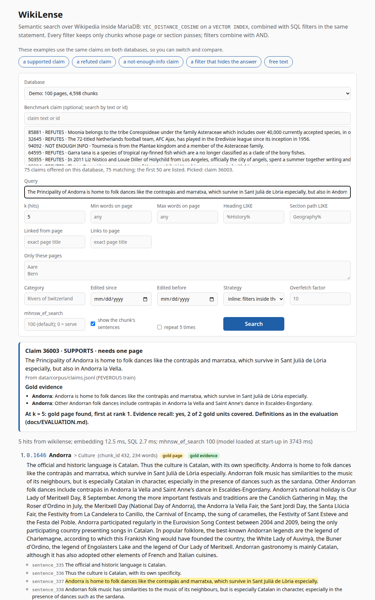

A project for area 4, "Vector search and RAG, natively" for the [MariaDB student database projects, 2026-09](https://mariadb.org/bachelor_hackathon_2026-09/).

# WikiLense

Semantic search over Wikipedia inside MariaDB, developed against **MariaDB 11.8.9**. Wikipedia
pages are cut into chunks, each chunk is embedded and stored in a `VECTOR(384)` column with a cosine
`VECTOR INDEX`, and a question is answered by one SQL statement: `ORDER BY VEC_DISTANCE_COSINE(...)`
together with ordinary predicates and joins. Claims of the FEVEROUS fact-verification benchmark are
the test queries and their gold evidence is the ground truth, so "it works well" is a number.

## Ask one question

```
git clone https://github.com/ylli-00/WikiLens.git && cd WikiLens
make setup
.venv/bin/wikilense query "Which river rises and ends entirely within Switzerland?" --k 1
```

```
 1. 0.3091  Aare  [chunk_id 1, 127 words]
    The Aare (German: [ˈaːrə]) or Aar (German: [aːɐ̯] (listen)) is a tributary of the High Rhine and
    the longest river that both rises and ends entirely within Switzerland. Its total length from
    its source to its junction with the Rhine comprises about 295 kilometres (183 mi), during which
    distance it descends 1,565 m (5,135 ft), draining an area of 17,779 km (6,865 sq mi), almost
    entirely within Switzerland, and accounting for close to half the area of the country, including
    all of Central Switzerland. There are more than 40 hydroelectric plants along the course of the
    Aare. The river's name dates to at least the La Tène period, and it is attested as Nantaror
    "Aare valley" in the Berne zinc tablet. The name was Latinized as Arula/Arola/Araris.
1 hit; model load 3691 ms, embedding 15.2 ms, SQL 5.7 ms (BAAI/bge-small-en-v1.5 on cpu, strategy inline, ef_search 100)
```

- That is the whole path. `make setup` needs Docker, Python 3.10 or newer and `make`. It starts
  MariaDB 11.8 in a container, builds a virtual environment with PyTorch's CPU build (`GPU=1` for
  CUDA) and loads the 100 Wikipedia pages committed here ([the list](data/corpus/MANIFEST.md)). Nothing has to be edited.
- The output is from a fresh clone with `make setup CPU=1` (the pinned versions), which took 4 minutes
  45 seconds ([the record](results/fresh_clone_run.md); [setup and platforms](#setup-and-platforms), also for a Mac).
- Put your own question between the quotes. The first number is the cosine distance. `--k 5`
  returns more passages, `--category`, `--min-words`, `--edited-since` and `--linked-from` filter
  them, `--explain` prints the SQL statement and MariaDB's plan, and `make serve` opens the same
  search as a web page at http://127.0.0.1:8000, with a claim picker, a database choice and examples.
- [docs/EXAMPLES.md](docs/EXAMPLES.md) has the filtered queries, the hybrid with full-text search, every
  option, a question that only a filter answers, and ten examples for the `mariadb` client that need no Python, also [without `make setup`](docs/SETUP.md#the-sql-examples-without-python).



## How it works

```
Wikipedia page -> sentences -> chunks of up to 240 words -> one vector of 384 numbers per chunk
               -> MariaDB: chunk.embedding VECTOR(384) with a VECTOR INDEX, beside page_id and section_id
question       -> vector -> one SQL statement: ORDER BY VEC_DISTANCE_COSINE(...) LIMIT k, with filters and joins
FEVEROUS claim -> the same statement -> its hits against the claim's gold evidence -> recall and latency
```

The page text is the December 2020 copy of Wikipedia that the FEVEROUS benchmark ships. We used it instead of a dump or the
API because the benchmark's gold evidence points at that copy's sentences. Categories are the explicit `[[Category:...]]`
links of each page's December 2020 revision, fetched from the MediaWiki API, and edit dates are that revision's timestamp
([docs/DATA.md](docs/DATA.md)).

Words used below:

- **Gold evidence**: the sentences FEVEROUS's annotators marked for a claim. A **gold page** is a page they are on.
- **S0** and **S1**: the two test corpora, the gold pages alone and with distractor pages added (the box below).
- **Index search** (strategy `none`): the bare statement. It walks the index's HNSW graph and is approximate.
- **Joined statement** (strategy `inline`): the same statement with joins and any filters. Without a filter its ranking is exact.

## What we found

On 3,000 FEVEROUS claims over 132,359 chunks, the gold page is among the top 5 chunks for 2,933
claims, the complete gold evidence for 2,253, and the index search takes 1.43 ms at the median.
Every number comes from a file in [results/scaled/](results/scaled/)
([SUMMARY.md](results/scaled/SUMMARY.md) has every table) or, for the demo corpus, in
[results/](results/); [docs/EVALUATION.md](docs/EVALUATION.md) has the method.

> **The ground-truth set** ("questions whose correct source article you already know") is 3,000
> claims of the FEVEROUS fact-verification benchmark, train and dev. A claim is a statement to
> verify, not a question. Each has an evidence set made only of text, and per label (supported,
> refuted, not enough information) 700 have their evidence on one page and 300 need two or more
> pages: six groups ([the claims](data/scaled/claims_3000.jsonl)). Annotators who searched all of
> Wikipedia marked the sentences each verdict rests on, so we know both the correct article and the
> correct sentences. We chose this over writing questions ourselves: questions written while
> reading an article reuse its words, which flatters recall. The claims are searched on two
> corpora: **S0**, the 3,851 gold pages (43,134 chunks), and **S1**, S0 plus, for each gold article
> with a usable link, the page it links to most among those not yet in the corpus (7,686 pages,
> 132,359 chunks; [docs/DATA.md](docs/DATA.md) has both rules).

The headline numbers use k = 5 and the index search (`wikilense eval`, 240-word chunks, `M=16`,
`mhnsw_ef_search=100`; [results/scaled/eval/](results/scaled/eval/)). The last row is the joined
statement that `wikilense query` above runs, which is exact and slower:

| | S0: gold pages | S1: with distractor pages |
|---|---|---|
| pages / chunks / HNSW graph | 3,851 / 43,134 / 56.0 MB | 7,686 / 132,359 / 156.0 MB |
| article recall@5 (gold page among the top 5 chunks' pages) | 0.984 (2,951) | 0.978 (2,933) |
| evidence recall@5 (a complete gold set inside the top 5 chunks) | 0.780 (2,341) | 0.751 (2,253) |
| evidence recall@5 reweighted to FEVEROUS's mix of the six groups | 0.891 | 0.870 |
| FEVEROUS-style evidence score: a complete gold set among the best 5 sentences + 25 list items of the top 10 chunks | 0.546 (1,637) | 0.529 (1,588) |
| index search, SQL p50 / p95; query embedding p50 (GPU) | 1.11 / 1.52 ms; 6.09 ms | 1.43 / 2.32 ms; 6.07 ms |
| exact joined statement, SQL p50; in brackets the index search timed in the same run | 15.74 ms (1.43 ms) | 25.81 ms (1.68 ms) |


- **Retrieval works at this size, and is fast.** The distractor pages cost little: from S0 to S1
  the table triples, evidence recall@5 falls from 0.780 to 0.751, and the search takes 0.3 ms longer.
- **One page is easy, two are not.** On S1 the complete evidence is in the top 5 chunks for 0.83
  to 0.96 of the claims on one page and for 0.29 to 0.55 of those that need two or more pages.
  FEVEROUS's own mix is mostly one-page claims, hence the higher reweighted value in the table
  ([the six groups and the weights](docs/EVALUATION.md#the-six-claim-groups)).
- **The four metadata predicates run inside the vector search, in one statement:** "only articles
  in this category, longer than this, edited since that date, linked from that other article".
  Without a filter the joined statement returns the exact top 5 for every claim. Under the four
  filters it returns 5 rows for every claim, the exact ones for 2,962 of 3,000; filtering after the
  index search comes back short for 2,801 ([the run](results/scaled/run1/s1/separate_index.md)).
- **One sequence leaves the index stale for everyone.** After a REPEATABLE READ reader searched
  before and after another connection's commit, index searches at any isolation level missed the
  committed rows, in 10 of 10 trials on a scratch table, until the next write
  ([isolation.md](results/isolation.md)). It is MariaDB issue
  [MDEV-41321](https://jira.mariadb.org/browse/MDEV-41321).
- **The settings chosen on 75 claims hold at scale.** On S1 the index's top 5 equals the exact
  top 5 for 2,911 of 3,000 claims, and it finds a gold page for 2,933 where the exact ranking finds
  2,943 ([timing](results/scaled/timing/)); the server defaults find far fewer ([below](#where-this-approach-loses)).
- **Where it loses.** A copy of the vectors in the application's memory answers the four-filter
  query, complete, in 2.44 ms; MariaDB needs 58.69 ms on S1 ([below](#where-this-approach-loses)).

## The data model

Eleven InnoDB tables, all in [sql/schema.sql](sql/schema.sql), which the code executes as it is. A
test compares the file, the code's column list and the live server.

| Table | Holds | Why it is shaped this way |
|---|---|---|
| `page` | one row per article: title, size counts, `revision_id` and `last_edited` of its December 2020 revision | `n_words` and `last_edited` are indexed: a selective length or date filter is read through that index, otherwise it is checked on the page row; `title` is `utf8mb4_bin`, so matching is exact |
| `section` | the heading tree: ordinal, heading, level, path such as `History > Roman history` | `heading` keeps the server's accent- and case-insensitive collation on purpose, so `LIKE '%history%'` matches `History` |
| `sentence` | one row per text unit (a sentence or a list item), with its FEVEROUS element key | the unit of gold evidence; every unit is stored, even empty ones, so evidence ids always resolve |
| `chunk` | the retrieval unit: text, word count, `embedding VECTOR(384) NOT NULL`, the `VECTOR INDEX` and a `FULLTEXT` index | the vector sits in the same row as `page_id` and `section_id`, so one statement can filter, join and rank |
| `chunk_sentence` | which sentences each chunk covers | turns "chunk in the top k" into "gold sentence in the top k" |
| `link` | every `[[link]]` in a page, with the target resolved to a `page_id` when it is in the corpus | "pages linked from X" becomes a join |
| `category`, `page_category` | category names and page-category pairs (40,695 and 58,569 in S1) | many-to-many; the index (`category_id`, `page_id`) answers "pages in C" |
| `claim`, `claim_evidence` | the FEVEROUS claims and every gold element id, resolved to `page_id` and `sentence_id` | the queries and the ground truth, joined by id and not by text |
| `ingest_meta` | model, chunk size, index parameters, corpus checksums, server version | every results file records the ingest it was measured on |

```sql
CREATE TABLE IF NOT EXISTS chunk (
    chunk_id   INT UNSIGNED NOT NULL AUTO_INCREMENT,
    page_id    INT UNSIGNED NOT NULL,
    section_id INT UNSIGNED NOT NULL,
    ordinal    INT UNSIGNED NOT NULL,
    text       TEXT NOT NULL,
    n_words    INT UNSIGNED NOT NULL,
    embedding  VECTOR(384) NOT NULL,
    PRIMARY KEY (chunk_id),
    UNIQUE KEY uq_chunk_page_ordinal (page_id, ordinal),
    KEY ix_chunk_section (section_id),
    FULLTEXT KEY ft_chunk_text (text),
    VECTOR INDEX (embedding) M=16 DISTANCE=cosine,
    CONSTRAINT fk_chunk_page FOREIGN KEY (page_id)
        REFERENCES page (page_id) ON DELETE CASCADE,
    CONSTRAINT fk_chunk_section FOREIGN KEY (section_id)
        REFERENCES section (section_id) ON DELETE CASCADE
) ENGINE=InnoDB DEFAULT CHARSET=utf8mb4;
```

Ownership references cascade: deleting a page deletes its sections, sentences, chunks, vectors and
category memberships in one statement, and a test checks it. Resolution references
(`link.to_page_id`, `claim_evidence.page_id`, `claim_evidence.sentence_id`) are `ON DELETE SET NULL`:
a link or a piece of gold evidence must survive the page it points to being re-ingested.
[docs/ARCHITECTURE.md](docs/ARCHITECTURE.md) has the diagram and a walk through the code.

## How MariaDB uses the vector index

The rules below add to the MariaDB documentation. Each was measured on 11.8.9 and is pinned by a
test or a results file. [docs/VECTOR_INDEX.md](docs/VECTOR_INDEX.md) has the statements, every
table and the method; the measurements are on S1 unless a line says otherwise.

- **Two statement shapes lose the index** besides the two the documentation names (a distance
  wrapped in an expression, a `WHERE` on the distance without `ORDER BY ... LIMIT`): a second
  `ORDER BY` key, and an `IN (subquery)` filter, which becomes a semi-join. So ties are broken in
  Python, and the link and category filters are joined as derived tables, with `DISTINCT` because a
  page can link to another one several times.
- **Three regimes of one statement** ([results](results/scaled/run1/s1/statement_forms.md)). The
  bare query is the HNSW search (2.16 ms at `ef_search` 100). A predicate on `chunk` itself keeps
  that search going until `k` rows pass: never short, but approximate (2,514 of 3,000 exact when
  12,341 chunks pass) and slow (33.30 ms). With a join, `EXPLAIN` still says `key: embedding`, but
  the result is exact for 2,984 to 3,000, at about 27 ms at `ef_search` 20 or 100.
- **The join order is fixed, and a very selective filter pays for it** ([200 claims](results/scaled/run1/s1/join_order.md)).
  The statement starts from `chunk` (`STRAIGHT_JOIN`). Under 15 of 18 filters the server then walks
  the vector index and reads more rows the fewer chunks pass: 1,386 to 1,388 ms when 66 pass. Left
  free, the optimizer sorts only the passing chunks: 0.86 to 3.13 ms when 662 or fewer pass, but
  1,567 and 1,689 ms when half pass, against 26 to 27 ms as written.
- **Vectors are rows.** An inserted chunk is searchable in the same transaction and gone after
  `ROLLBACK`; another connection sees it after `COMMIT`; deleting a page cascades to its vectors. A
  search sees what its isolation level allows, through the index as by a scan, with two caveats. A
  search over rows its own transaction has not committed finds fewer true neighbours: on S0, 0.872
  to 0.881 of the exact top 5 at every `mhnsw_ef_search`, against 0.973 to 0.999 after `COMMIT`
  ([the run](results/scaled/run1/s0/uncommitted_recall.md)). The second is the stale index above:
  with a `DELETE` in that sequence the index returned no row at all, until the next committed write
  or `FLUSH TABLES`. So no index search should run in a REPEATABLE READ transaction whose snapshot predates another connection's commit.
- **No hard cap, and a search that runs away** ([30 claims](results/scaled/run1/s1/hard_cap.md), [three versions](results/scaled/version_probe/version_probe.md), [in SQL only](results/scaled/runaway_repro/runaway_repro.md), [MDEV-42358](https://jira.mariadb.org/browse/MDEV-42358)). A `WHERE` inside
  the statement is not capped at `LIMIT`, as the documentation says it is. When fewer rows pass, 11.8.9 keeps searching: a threshold only 3 chunks meet ran to a 10 s `max_statement_time`
  in 57 of 60 executions, and under a 60 s limit `mariadbd` outgrew a 2 GB container and was killed. 12.3.3 and 13.0.2 took 42 to 150 MB for such a statement and were not killed, and joined filters never ran away. The page and `wikilense query` stop a search after 5 s ([setting](docs/SETUP.md#afterwards)).
- **Results are reproducible up to the graph build.** At the chosen settings twenty S1 builds found 2,922 to 2,937 gold pages; two builds agree on 2,838 to 2,907 of 3,000 hit lists ([builds](results/scaled/run1/s1/build_variance.md)).

## What the database-native approach gave

- **One statement.** "Chunks about X, in a category, longer than N words, edited since D, linked
  from Y" is a single statement that the optimizer plans, and `EXPLAIN` shows the plan. The link
  graph and the categories are joined, not copied next to each vector.
- **One transaction, one set of foreign keys.** Vectors roll back with their
  transaction and disappear with their page; there is no synchronisation job between two stores.
- **The ground truth in the same database.** `claim_evidence` resolves every gold element to a
  `sentence_id`, so the evaluation matches ids, not text; the `FULLTEXT` index sits on the same
  table as the vectors, and the two rankings are fused with window functions and CTEs.

## Where this approach loses

We looked for the cases where MariaDB is the worse home for the vectors. The first two are measured
on S1 ([results/scaled/run1/s1/separate_index.md](results/scaled/run1/s1/separate_index.md)); the
others compare MariaDB's documentation with a dedicated store's. We did not measure a dedicated vector store.

1. **Latency, while the corpus fits in memory.** An exact NumPy scan of the 132,359 vectors held in
   the application takes 10.19 ms, or 11.06 ms once the hit rows are fetched from MariaDB, which is
   slower than MariaDB's index search (2.87 ms in the same run). An in-memory HNSW graph (hnswlib,
   `M=16`) answers in 0.36 ms, with 0.961 of the exact top 5 against MariaDB's 0.993.
2. **Filtered queries that must be complete.** Under the four filters (3,107 chunks pass) MariaDB's joined
   statement takes 58.69 ms; filtering the copy first and fetching the rows takes 2.44 ms and
   is exact. The copy costs 203,303,424 bytes of vectors (the process grew by 701,804,544 bytes) and an export
   of four relational tables; it is stale after the next write and outside every transaction.
3. **No filter-aware index.** A filtered search here walks the whole index exactly, filters after
   the search, or skips the vector index and sorts the rows that pass. Qdrant documents an HNSW graph
   "with additional edges based on indexed payload values" to "apply filters as you search in the
   graph" ([Qdrant, Indexing](https://qdrant.tech/documentation/manage-data/indexing/)); MariaDB
   documents no such structure.
4. **One vector index per table, few knobs.** MariaDB allows one vector index per table, two
   distances and no dot product, and its index stores 16-bit integers with `ef_construction` fixed
   at 10; Qdrant documents several named vectors per point, a configurable `ef_construct`,
   quantization and sharding ([the citations](docs/VECTOR_INDEX.md#mariadb-and-a-dedicated-vector-store-from-their-documentation)).
5. **Tuning and care are on you.** With the server defaults (`M=6`, `ef_search` 20) twenty S1 builds
   found 2,218 to 2,433 gold pages where the exact ranking finds 2,943, and the default 16 MB index
   cache does not hold S1's 156.0 MB graph: the search then finds a gold page for 2,658 of 3,000
   claims instead of 2,933, and with 64 to 160 MB the joined statement takes 166 to 493 ms instead
   of 27 to 28 ([the cache](docs/VECTOR_INDEX.md#the-index-cache-below-and-above-the-graph)). The
   lower recall over uncommitted rows and the stale index are not in the documentation we read.

## Extension: an LLM fact-checker

Does a small model, Claude Haiku 5.5, judge a FEVEROUS claim better when it reads the top 5 chunks of the `inline` statement on S1
(RAG), and does that help more than letting it search the web? Each of the 3,000 claims was judged four ways ([the setup](docs/LLM_EXTENSION.md#2-the-setup)):

| accuracy | no passages | web search | RAG | gold passages |
|---|---|---|---|---|
| three classes (3,000 claims) | 45.2% | 61.3% | 70.9% | 72.9% |
| supported/refuted only (2,000 claims) | 35.3% | 81.9% | 83.6% | 82.9% |

On three classes RAG is ahead of web search by 9.6 points (95% interval 8.0 to 11.2), and the gold passages are ahead of RAG by 2.0 (0.7 to 3.3).
On the supported/refuted claims it is ahead of web search by 1.7 points (0.1 to 3.3), a little above two rerun standard deviations (1.3), and level with gold.
Most of the three-class gap is NOT ENOUGH INFO, a label FEVEROUS's annotators gave from December 2020 Wikipedia without outside
knowledge: web search gives that answer least often and gets only 20.1% of the NOT ENOUGH INFO claims right. [docs/LLM_EXTENSION.md](docs/LLM_EXTENSION.md) has the rest.
The web page can run this RAG check live on a typed statement when the server is [set up for it](docs/SETUP.md#turn-on-the-live-fact-check);
without that, its "Copy the prompt" box gives that prompt, with one sentence changed, and the passages to paste into any chatbot ([details](docs/LLM_EXTENSION.md#14-on-the-web-page)).

## Setup and platforms

`make setup` does four things, each of which you can run by hand ([docs/SETUP.md](docs/SETUP.md)):
it writes `.env` with two generated passwords, starts MariaDB 11.8 with `docker compose up -d --wait`
(bound to `127.0.0.1:3306`), creates `.venv` and installs the package, and runs `wikilense ingest`.
The ingest loads the 100-page demo corpus and ends with a report to compare against this one:

```
  pages 100, sections 3173, sentences 33637 (empty 372), chunks 4598
  links 40542 (resolved 373, skipped 0)
  claims 75, evidence ids 114 (page resolved 114, sentence resolved 87)
  page metadata 100 of 100 pages, categories 1005 (page_category 1123)
```

Then `make test` (933 tests), `make eval`, `make serve`, `make examples` (the ten examples of `sql/examples.sql`,
no Python needed), `make experiments` (the protocol on the 100 pages, with a GPU) and `make down`. `make eval` checks
an install: on the 100 pages it finds the gold page among the top 5 chunks for 74 of 75 claims and the complete evidence
in the top 10 for 60 of 66 (`results/final_ef_100.md`), up to the HNSW build. The scaled run needs the 53.5 GB FEVEROUS
Wikipedia, a GPU and hours ([its commands](docs/SETUP.md#reproduce-the-scaled-run)). Its database S1 loads without them:
`make fetch-s1 load-s1` downloads a 300 MB release file and loads it (221.1 s on this laptop; [how](docs/SETUP.md#get-the-scaled-database-s1)).

**Without a GPU** everything works; only the embedding is slower. The ingest took 230.0 s on this
laptop's CPU against 21 s on its GPU, and a query embedding takes 18 ms against 4.6 ms. The SQL times
do not change. So `make setup` installs PyTorch's CPU build (1.5 GB against 5.8 GB for the GPU build); `CPU=1` pins CPU-only versions (1.4 GB; Python 3.12 or newer).

**Platforms.** On Linux x86_64 all three were run: the default's install and the tests, `GPU=1` on the author's laptop,
`CPU=1` from a fresh clone; CI installs that lock file on every push. On macOS 14 or newer with Apple
Silicon both resolve: pip's and uv's resolvers find every package for that platform, but it was not run
there, because we have no Mac and no Windows machine. [The platform table](docs/SETUP.md#platforms) has
macOS 13, Intel Macs and Windows, and the commands behind each cell.

## Method

Each of the 3,000 claims is embedded once and searched once per `k` (1, 3, 5, 10, 20) with
`LIMIT k`; the results table above defines the two recalls. Latency is the SQL round trip of one search,
warm, 5 timed passes per claim after one untimed pass (15,000 samples per `k`), reported as p50 and
p95; the query embedding is timed separately. Each database was measured twice: recall was identical
and the latencies differ by at most 1.3%. The scaled run was measured with the laptop's CPU capped
at 50% and the GPU at 2,100 MHz, one job at a time, so its times are comparable with each other but
not with the 100-page ones. Machine: i9-13900H, RTX 4060 Laptop GPU, MariaDB 11.8.9 in Docker,
Python 3.12, PyMySQL 1.2.3, sentence-transformers 6.0.1. The database measurements
([docs/VECTOR_INDEX.md](docs/VECTOR_INDEX.md)) time each claim once after one untimed run, the index
cache in two passes per size, and the join order on a fixed sample of 200 claims, because by a
[20-claim pilot](results/scaled/pilot/) all 3,000 would take about 100 hours.

The settings were chosen on the 75-claim development set over the 100-page corpus and kept for the scaled run:

| Parameter | Chosen | Why (evidence in [docs/EVALUATION.md](docs/EVALUATION.md#parameters-and-why)) |
|---|---|---|
| Embedding model | `BAAI/bge-small-en-v1.5`, 384 dimensions | small enough for a CPU, built for passage retrieval; no second model was measured |
| Embedded text | `title > section path: chunk text` | on the development set the prefix raises evidence recall@20 from 61 to 63 of 66 on the exact ranking |
| Chunk size | 240 words, overlap 1 unit, never across a section | overlap 1 was not swept; on the development set, at equal retrieved text 60-, 120- and 240-word chunks give the same article recall and evidence recall within 3 claims (54, 57, 55 of 66); 240 stores 4,598 vectors, not 8,658 or 19,065 |
| Index `M` (links per node in the graph) | 16 (server default 6) | on the development set (120-word chunks) at `ef_search=20`, article recall@10 is 67, 74 and 73 of 75 for M 6, 16 and 32; the exact ranking gives 74 (another build of the `M=6` graph gave 68: builds differ) |
| `mhnsw_ef_search` (candidates the search keeps) | 100 per query (server default 20) | on the development set the hit lists equal the exact ranking for 74 of 75 claims against 65 at 20, for 0.51 ms instead of 0.45 ms |
| Strategy with filters | `inline` (the joined statement) | complete or fast, not both: on the 3,000 claims under `heading LIKE '%History%'`, `inline` fills all 5 rows for every claim in 26.59 ms on S1; `overfetch`, which filters after the index search, takes 1.87 ms and comes back short for 2,425 of them |

## Limitations

- Claims that need two or more pages are the weak spot: on S1 the FEVEROUS-style evidence score is
  0.260, 0.080 and 0.103 for the three labels there, against 0.593 to 0.747 on one page.
- Tables and captions are not indexed, so only claims with a text-only evidence set were picked:
  43,957 of FEVEROUS's 79,181 train and dev claims (56%) have none
  ([the count](results/scaled/data/text_only_count.json)).
- The corpora stop at 132,359 chunks, on one server, with one client. FEVEROUS's own retriever searches 5.4 million pages
  ([the paper](https://arxiv.org/abs/2106.05707)), so our scores cannot be compared with the paper's, and the embedding model was
  fine-tuned on FEVER over Wikipedia, so recall on other text is probably lower ([the caveat](docs/EVALUATION.md#the-embedding-models-training-data)).
- The database measurements have one run, unlike the recall and latency above, and the join order
  covers 200 of the 3,000 claims; a rerun adds a column to [SUMMARY.md](results/scaled/SUMMARY.md).
- No free text is generated: the project measures retrieval, and the LLM fact-checker
  ([above](#extension-an-llm-fact-checker)) returns a verdict with one sentence of justification and is scored on the verdict only.

## Repository

To learn the feature, five files are enough: [sql/schema.sql](sql/schema.sql) (the tables), [sql/examples.sql](sql/examples.sql)
(ten statements to run), [wikilense/search.py](wikilense/search.py) (every search statement as a named constant),
[docs/EXAMPLES.md](docs/EXAMPLES.md) and [docs/VECTOR_INDEX.md](docs/VECTOR_INDEX.md). The rest builds, measures and tests it.
[wikilense/](wikilense/) is the package (its `llm/` folder and `factcheck.py` are the LLM extension),
[scripts/](scripts/) builds the corpora and runs the experiments, [data/](data/) holds the demo corpus and the 3,000
claims, [results/](results/) every experiment as JSON and Markdown, and [docs/](docs/) the reference pages
([ARCHITECTURE.md](docs/ARCHITECTURE.md) lists every file). [analysis/](analysis/) is the earlier FEVEROUS analysis
that chose the benchmark. [tests/](tests/) holds
933 tests, and [CI](.github/workflows/ci.yml) runs ruff and the whole suite against a `mariadb:11.8.9` service on every push to `main` and pull request.

## Team

Ylli Rada, Constructor University, Databases and Web Services course. Code, experiments and
documentation were produced with Claude Code (Anthropic), directed by the author. The code is under
the MIT licence ([LICENSE](LICENSE)). The Wikipedia text and FEVEROUS material in `data/corpus/`, `data/scaled/`, the per-claim
files of `results/` and `analysis/feverous/feverous_claims.csv` keep their own licence, CC BY-SA 3.0
([data/corpus/NOTICE.md](data/corpus/NOTICE.md)); FEVEROUS is Aly et al., 2021 (https://arxiv.org/abs/2106.05707).
