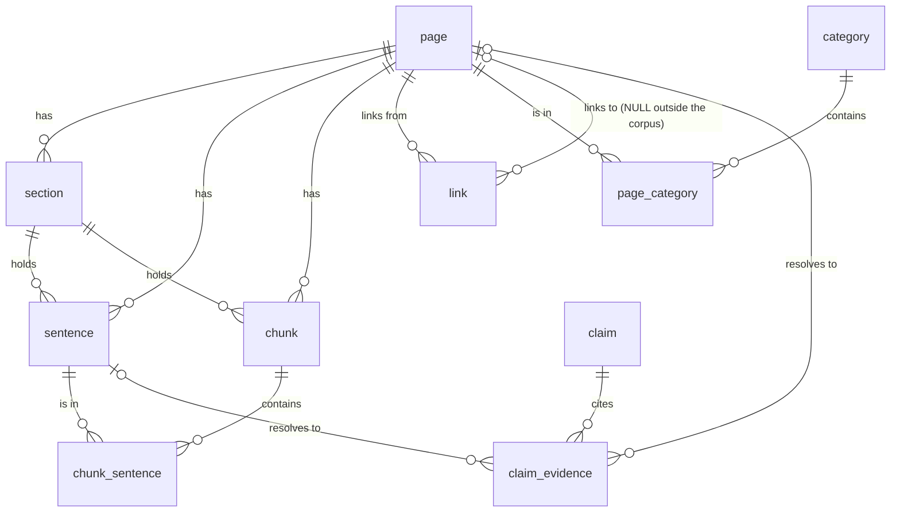

# How WikiLense is built

This page guides someone new to vector search and MariaDB through the code: from the downloaded
files to a search result and a recall number, then every file. [DESIGN.md](DESIGN.md) holds the module
contract and the reasons for each choice, the [README](../README.md) the results. The examples ran
on the committed 100-page demo corpus; other numbers name their file under `results/`.

For the commands, the header comment of the [Makefile](../Makefile) lists the `make` targets,
[SETUP.md](SETUP.md) has the setup and the scaled run, [EXAMPLES.md](EXAMPLES.md) every way to
query, and [EVALUATION.md](EVALUATION.md) how to rerun the measurements.

## 1. What WikiLense does

WikiLense finds the passages of Wikipedia that mean the same as a question, whether or not they
share its words, entirely inside MariaDB 11.8. Pages are cut into passages called chunks; each
chunk becomes 384 numbers that describe its meaning, stored next to the page's title, sections and
links. A query becomes numbers the same way, and one SQL statement returns the closest chunks:
`wikilense query "Aare river in Switzerland" --k 3` returns the lead of *Aare* (distance 0.0939)
and two chunks of its *Course* section (0.1688 and 0.1919). The same statement can add "only
sections headed *History*" or "only pages that *Aare* links to". The test queries are
fact-checking claims from FEVEROUS, whose annotators marked the sentences that prove or refute them.

## 2. The pipeline at a glance

```mermaid
flowchart TD
    F["data/feverous/<br/>FEVEROUS claims (train, dev)<br/>+ Wikipedia shard wiki_000.jsonl<br/>(downloaded, not in git)"]
    B["scripts/build_corpus.py<br/>picks 75 claims and 100 pages"]
    C["data/corpus/<br/>pages.jsonl, claims.jsonl, MANIFEST.md<br/>(committed)"]
    W["scripts/fetch_page_meta.py<br/>MediaWiki API: each page's Dec 2020<br/>revision, edit date, categories"]
    P["data/corpus/page_meta.jsonl<br/>+ PAGE_META.md (committed)"]
    I["wikilense ingest (ingest.py)<br/>parse (wikitext.py) → chunk (chunking.py)<br/>→ embed (embedding.py) → load (db.py)"]
    M[("MariaDB 11.8<br/>page, section, sentence, chunk (VECTOR),<br/>chunk_sentence, link, category,<br/>page_category, claim, claim_evidence,<br/>ingest_meta")]
    S["search (search.py)<br/>wikilense query · wikilense serve"]
    E["evaluate (evaluate.py)<br/>wikilense eval · scripts/run_experiments.py"]
    R["results/<br/>JSON + Markdown per run, SUMMARY.md"]
    F --> B --> C --> I --> M
    C --> W --> P --> I
    M --> S
    M --> E --> R
    S -.->|the same search() function| E
```

`scripts/fetch_wiki_shard.py` downloads one Wikipedia shard (`wiki_000.jsonl`, 9,996 pages)
without the 10 GB archive; `data/feverous/` is not committed (two files are over GitHub's 100 MB
limit). `scripts/build_corpus.py` picks the 75 claims whose evidence lies entirely in that shard,
their 54 evidence pages and 46 "filler" pages they link to (realistic distractors), and
`scripts/fetch_page_meta.py` adds each page's December 2020 revision, edit date and categories.
`wikilense ingest` parses, chunks, embeds and fills eleven tables in about 21 s on the RTX 4060,
17 s of it embedding (`results/SUMMARY.md` section 8). `search.search()` ranks chunks by cosine
distance with any filters in the same statement; `evaluate.evaluate()` checks every claim's hits
against its gold evidence in `claim_evidence`.

The scaled run is the reported result: the same code on 3,000 FEVEROUS claims (per label, 700
on one page and 300 on two or more) in two databases. `wikilense_s0` (S0) holds their gold pages,
43,134 chunks; `wikilense_s1` (S1) adds one distractor per gold page (the page it links to most
among those not yet in the corpus), 132,359 chunks. The `scripts/scaled_*.py` scripts build, load
and measure it; [DATA.md](DATA.md) and [EVALUATION.md](EVALUATION.md) describe data and results.

## 3. Key ideas for a beginner

**Embedding, vector, cosine distance.** An *embedding model* (`BAAI/bge-small-en-v1.5`) turns a
text into a *vector* of 384 numbers; texts with similar meaning point in similar directions.
*Cosine distance* is 1 minus the cosine of the angle between two vectors (0 for the same
direction); MariaDB computes it with `VEC_DISTANCE_COSINE(a, b)` over a `VECTOR(384)` column.

**Chunk.** The unit that gets one vector: consecutive sentences, at most 240 words, overlapping its
neighbour by one sentence (`chunking.chunk_units`). A chunk never crosses a section heading, so it
holds one topic and has one section path (such as `Afghanistan > History`) for the heading filter.

**HNSW index, `M`, `mhnsw_ef_search`.** Reading all 4,598 chunk vectors for every query gets slow
as the table grows. MariaDB's vector index, *HNSW* (hierarchical navigable small world), is a graph
that links every vector to a few similar ones; a search hops towards the query instead of reading
every row. `M` is the links per vector (16, in `sql/schema.sql`), `mhnsw_ef_search` the candidates
a search keeps (100 per query here; the server default is 20): more is closer to exact and slower.

**Exact versus approximate, and `EXPLAIN`.** HNSW may miss a close vector that an exact scan finds;
at M=16 and `mhnsw_ef_search` 100 the two hit lists are equal for 74 of 75 claims
(`results/SUMMARY.md` section 7). With a join (strategy `inline`), MariaDB ranks exactly over the
index ([VECTOR_INDEX.md](VECTOR_INDEX.md)). `EXPLAIN` shows a statement's plan without running it;
`type index, key embedding` on the `chunk` row means the vector index drives the search.

**`FULLTEXT` and RRF.** A `FULLTEXT` index (`MATCH(text) AGAINST (...)`) finds rows with the query's
*words*. *Reciprocal rank fusion* (strategy `rrf`) scores each chunk `1 / (60 + rank)` in the vector
and the full-text ranking and sorts the sums, so a good keyword match can still be found.

**recall@k, latency p50 and p95.** *Article recall* counts a claim when a gold page is among the
pages of the top-k chunks; *evidence recall* when every gold sentence of one evidence set is inside
them (through `chunk_sentence`), over the 66 claims whose evidence is sentences and list items (the
other 9 need table cells, which are not indexed). Each claim is searched 5 times; *p50* is the
median time, *p95* the slow tail. Demo defaults at k=10: article recall 74 of 75, evidence recall
60 of 66, SQL p50 0.51 ms and p95 0.94 ms, query embedding p50 4.58 ms on the GPU and about 18 ms
on the CPU (`results/final_ef_100.md`, `results/final_ef_100_rerun_cpu1.md`).

## 4. File by file

### The package `wikilense/`

| File | What it is for | Reads / writes | Calls | Read first |
|---|---|---|---|---|
| `__init__.py` | Package marker and `__version__` (0.1.0), recorded in `ingest_meta` and every result. | - | - | - |
| `config.py` | Every setting as a `WIKILENSE_*` variable from the environment or `.env`, with the defaults (240 words, overlap 1, the model and its pinned revision, `ef_search` 100, the 5 s search time limit `WIKILENSE_STATEMENT_SECONDS`). | reads `.env` | python-dotenv | `load_settings` |
| `corpus.py` | Reads `data/corpus/*.jsonl`, parses FEVEROUS element ids (`Aare_sentence_0` → page, type, key), holds the corpus selection rule. | the JSONL files | - | `select_corpus` |
| `wikitext.py` | Parses a FEVEROUS page into one `TextUnit` per sentence and list item under its section headings; cleans markup (`[[target\|shown]]` → `shown`), finds hatnotes and links. | - | - | `parse_page` |
| `chunking.py` | Groups a page's units into chunks (at most `max_words`, never across a section, one unit of overlap); `embedding_text` adds the `title > section path:` prefix. | - | `config`, `wikitext` | `chunk_units` |
| `embedding.py` | `Embedder`: loads the model lazily (on the GPU when there is one) at its pinned revision; `embed_queries` prepends the BGE query instruction, `embed_passages` does not. | the Hugging Face model cache | `config`; sentence-transformers, torch | `Embedder.embed_queries` |
| `db.py` | The MariaDB layer: `connect`, `apply_schema`, `insert_rows` with an allowlist of tables and columns (`SCHEMA_COLUMNS`), `vec_param` (the bytes of a `VECTOR`), the one allowed session variable, `EXPLAIN`. | the database; `sql/schema.sql` | `config`; PyMySQL | `insert_sql` |
| `ingest.py` | `wikilense ingest`: checks settings and model, then seven steps (schema, pages, chunks with embeddings, links, `ANALYZE TABLE`, claims and evidence, `ingest_meta`), each committed when done. | `data/corpus/` → all eleven tables | `db`, `corpus`, `wikitext`, `chunking`, `embedding` | `_Ingest.run` |
| `search.py` | The four strategies (`inline`, `overfetch`, `none`, `rrf`), the `Filters` (words, heading, path, links, titles, category, edit date), every SQL statement as a named constant or fragment, `ef_search` set per call and restored, and so is `max_statement_time` when the caller passes a time limit (the web page and `wikilense query` do). | the database (read only) | `db`, `config` | `search_statement` |
| `evaluate.py` | Recall and latency: ground truth from `claim_evidence`, pure metric functions, one untimed and `repeats` timed passes per claim and k, the JSON and Markdown writer. | the database → `<out>/<name>.json/.md` | `db`, `search` | `evaluate` |
| `cli.py` | The `wikilense` command (`init-db`, `ingest`, `query`, `eval`, `serve`): argument checks, one-line errors, exit codes 0, 1, 2 and 130, the text output of `query`. | stdout / stderr | `db`, `ingest`, `search`, `evaluate`, `embedding`, `web` | `cmd_query` |
| `web.py` | FastAPI: `GET /` is one self-contained page (its script writes with `textContent` only), `GET /api/search` returns hits, SQL, `EXPLAIN` and timings, and with `claim_id`, `database` or `repeat` also the claim's marks and summary, the database that answered and the repeated timings; `/api/databases`, `/api/claims` and `/api/pages` feed the database selector, the claim picker and the page list; `GET /api/factcheck` says whether the live fact-check is on and `POST /api/factcheck` runs it (the search again, then one model call); `GET /api/prompt` returns the copy box's text (the search again, no model call); a search MariaDB stops at the time limit is a 504; `/docs` is the API page. | the demo database and `wikilense_s1` when loaded (read only) | `db`, `search`, `picker`, `factcheck`, `evaluate`, `embedding`; FastAPI | `api_search` |
| `factcheck.py` | The page's live fact-check, off unless `WIKILENSE_FACTCHECK` is `subscription` or `api`: reads the LLM experiment's RAG run record and prompt set (refused if the hash differs), builds the request with the runner's `Runner.request`, makes one call per click through the CLI or API backend, splits the reason's citations, and reads the reliability figures from `results/llm/llm_results.json`. Also the copyable prompt, loaded whatever the setting: the same request as one text to paste into a chatbot, with its one changed sentence (a plain answer instead of the tool call). | `results/llm/runs.json`, `results/llm/llm_results.json`, `wikilense/llm/prompts/fact_check_v1/` | `llm.runner`, `llm.cli_backend`, `llm.api_backend`, `llm.claims`, `llm.retrieval` | `FactChecker.run` |
| `picker.py` | The page's claim picker: reads both claim files, decides which claims a database offers (gold pages in `page`, gold sentences resolved by `ingest.resolve_element`), builds their ground truth with `evaluate.ground_truth_from_rows`, and computes a search's marks and summary with the evaluation's metric functions; the ready-made examples and the rule that chose them. | `data/corpus/claims.jsonl`, `data/scaled/claims_3000.jsonl`, the database (read only) | `corpus`, `evaluate`, `ingest`, `search` | `build_catalog` |

`wikilense/llm/` is the package of the LLM fact-checker extension, with the `scripts/llm_*.py` scripts and the `tests/test_llm_*.py` tests; it is documented in [LLM_EXTENSION.md](LLM_EXTENSION.md).

### `sql/`

| File | What it is for |
|---|---|
| `schema.sql` | The only definition of the data model: eleven `CREATE TABLE IF NOT EXISTS` statements, with `embedding VECTOR(384)`, `VECTOR INDEX (embedding) M=16 DISTANCE=cosine` and `FULLTEXT KEY ft_chunk_text (text)`. A test checks it against `db.SCHEMA_COLUMNS`. |
| `examples.sql` | Ten statements for the `mariadb` client alone: the bare index query, predicates and joins, the link filter, over-fetch, RRF, the join back to sentences, the vector as text, vectors in a transaction, the four metadata filters in one statement with its EXPLAIN, a page's revision and categories. A test runs every one. |
| `docker-init/01-test-database.sh` | Run once when the container's volume is created: makes the `<name>_test` database for the tests and grants it to the application user. |

### `scripts/`

| File | What it is for | Reads / writes |
|---|---|---|
| `fetch_wiki_shard.py` | Downloads one FEVEROUS Wikipedia shard with HTTP range requests (only that member of the zip) and checks its CRC. | → `data/feverous/wiki_pages/` |
| `build_corpus.py` | Applies `corpus.select_corpus`; writes the corpus with a manifest of counts and SHA-256 digests, the same bytes on every run. | `data/feverous/` → `data/corpus/` |
| `fetch_page_meta.py` | Each corpus page's revision live at the end of December 2020 (by sentence matching for pages edited that month, moved pages through the move log): id, timestamp, categories. One polite request at a time. | → `page_meta.jsonl`, `PAGE_META.md` |
| `run_experiments.py` | The protocol behind `results/`: groups `stability`, `ef_search`, `index_m`, `chunk_size`, `prefix`, `filters`, `final`, `restore`, `uncommitted`, `planner`, `scale` and `summary` (rebuilds `results/SUMMARY.md`). Root SQL goes through `docker exec`, the password in the environment only. | the main database, docker → `results/` |
| `make_charts.py` | The README charts as SVG, with a dark variant. | `results/` → `docs/img/` |
| `compare_separate_index.py` | Where the database-native search loses: MariaDB's statements against an exact NumPy scan of a copy of the vectors and, when installed, hnswlib (in no requirements file). Takes `--database`, `--k` and `--filters` (the `four_filters` case of a `scaled_filters.py` file), and more (`--help`). | the database (read only) → `results/separate_index.*` |
| `measure_index_behaviour.py` | Six measured behaviours of the index, five that its documentation does not describe: `forms`, `join_order`, `builds`, `cache`, `isolation` ([VECTOR_INDEX.md](VECTOR_INDEX.md)), and `hard_cap`, the documentation's "hard cap" on a distance threshold (only with `--throwaway-server`, never against the project's server). Takes `--database`, `--k` and `--filters` (a `scaled_filters.py` file, for `join_order`), and more (`--help`). | the corpus database, scratch tables in the test database; `cache` sets a server variable and restores it → `results/` |
| `make_env.py` | Writes `.env` from `.env.example` with two random passwords, once; never prints them or touches an existing file. | `.env.example` → `.env` |
| `scaled_build.py` | The scaled run's data: picks the 3,000 claims (seeded, only claims whose evidence lands in a chunk) and the distractor pages, and writes the S0 and S1 corpus folders. | the FEVEROUS database (read only) |
| `scaled_check.py` | Re-derives every rule of the build with separate code and compares the results. | writes only `SELFCHECK.md` |
| `scaled_stage2.py` | Creates `wikilense_s0` and `wikilense_s1`, embeds every chunk text in saved parts, ingests each folder and checks the counts. | refuses any other database (`wikilense_s1_check`, a scratch copy for testing a load, only with `--allow-check-database`) |
| `scaled_stage3.py` | Each page's December 2020 revision, edit date and categories (resumable, with `fetch_page_meta.py`'s client), loaded so the four metadata filters work at scale. | MediaWiki API → a scaled database |
| `scaled_release.py` | `make fetch-s1`: downloads S1's release file, checks its size and SHA-256 and unpacks it, folders and regular files only. `make load-s1`: stops first when the target database already holds tables. | release file → `data/scaled/wikilense_s1/` |
| `scaled_filters.py` | Values for the four metadata filters by one rule: the chunks kept nearest to 50%, 5%, 0.5% and 0.05% of the table. | → the file `--filters` reads |
| `scaled_timing.py` | The `scale` protocol of `run_experiments.py` (fast and slow statements) on every claim of a scaled database, at k = 5. | a scaled database |
| `scaled_uncommitted.py` | The `uncommitted` group with a scaled database's vectors. | a scratch table in the test database |
| `scaled_sentence_score.py` | The FEVEROUS-style evidence score: of the units in the top 10 chunks, the 5 sentences and 25 list items closest to the claim, and whether a whole gold set is among them. | a scaled database |
| `scaled_page_coverage.py` | Page coverage as FEVEROUS reports it: the share of a claim's gold pages among the first 1, 2, 3, 5 and 10 distinct pages of its top 50 chunks. | a scaled database |
| `scaled_breakdown.py` | Recall split by label, page count and challenge tag, and reweighted to FEVEROUS's mix of those groups; a label check per metric, and equal label weights per tag where recall differs by label. | result files, no database |
| `scaled_summary.py` | Every table of the scaled run in one file, one column per run. | `results/scaled/` → `results/scaled/SUMMARY.md` |

### `tests/`

`conftest.py` holds the fixtures: the settings and a connection to the *test* database (schema
reset per test). It skips `db` tests without MariaDB and `slow` tests without the model, and
refuses the main database or any name not ending in `_test`. Most `test_*.py` files are named after
what they test (`test_experiments.py` covers `run_experiments.py`), with hand-made pages, fake
embedders and known distances. `test_neutral_text.py` keeps comments free of attribution notes and
personal details; `test_docs.py` checks the README, every link and anchor, and the test counts.

### Data, results and top-level files

| File | What it is for |
|---|---|
| `data/corpus/` | The committed demo corpus (pages, claims, page metadata, manifests) and `NOTICE.md`: the CC BY-SA 3.0 licence of its Wikipedia text and claims, which the code's MIT licence does not cover. `data/feverous/` holds the raw downloads, not committed. |
| `data/scaled/` | `claims_3000.jsonl`, the scaled run's claims with their evidence sets, gold pages and gold evidence text, and `NOTICE.md`, its licence. `make fetch-s1` unpacks S1's release file into `wikilense_s1/` here, which git ignores. |
| `results/`, `results/scaled/` | The result files (JSON and Markdown) of the demo corpus and of the scaled run, each folder with its `SUMMARY.md`. |
| `README.md` | One question and its answer on the first screen, then a sketch of how it works, the findings, the data model, how MariaDB uses the index, what the approach gave and where it loses, setup, the method. |
| `CLAUDE.md` | The project's rules for Claude Code sessions: the task, the benchmark facts, the environment, the rules for comments. |
| `Makefile` | `make setup` (a Python check, `.env` with generated passwords, MariaDB, the venv, the ingest; `CPU=1` for the pinned CPU-only set), `test`, `lint`, `eval`, `serve`, `examples`, `experiments`, `fetch-s1` and `load-s1` (the scaled database S1 from its release file), `down`; `make -n <target>` prints the commands. |
| `docker-compose.yml`, `.env.example` | MariaDB 11.8 as `wikilense-mariadb` on `127.0.0.1:3306`, with a 512 MB HNSW cache and a health check; the template for the ignored `.env`. |
| `pyproject.toml`, `requirements*` | The package, the `wikilense` command, pytest markers, ruff; version ranges, and exact versions in `requirements.lock` (the GPU build behind `results/`) and `requirements-cpu.lock` (CPU only, per-platform PyTorch lines). |
| `.github/workflows/ci.yml` | On every push to `main` and every pull request: MariaDB 11.8 as a service, the CPU lock, the Anthropic SDK of `requirements-llm.txt`, ruff and the whole suite. |
| `analysis/feverous/` | How many FEVEROUS claims need several pages (`feverous_analysis.py`, its outputs, the report `FEVEROUS_ANALYSIS.md`); `scripts/scaled_breakdown.py` reads its `feverous_claims.csv`. |
| `LICENSE`, `.gitignore` | The MIT licence; what git leaves out (the venv, caches, `.env`, the raw downloads). |

## 5. One query, end to end

```
wikilense query "When was Kabul founded?" --heading '%History%' --k 3 --explain
```

1. `cli.cmd_query` reads the settings (`config.load_settings()`, from `.env`) and turns the
   options into `search.Filters(heading_like="%History%")`; `%` is the SQL `LIKE` wildcard. No
   `--ef-search` was given, so the settings' 100 applies. `_require_chunks` runs
   `SELECT COUNT(*) FROM chunk`, so an empty database fails with one line before the model loads.
2. The `Embedder` loads the model (about 5 s, timed on its own); `embed_queries([text])` prepends
   "Represent this sentence for searching relevant passages: " and returns 384 numbers.
3. `search.search_statement` checks the arguments (`db.vec_param` turns the vector into 1,536
   bytes) and assembles the `inline` statement from named fragments, every value a `%s` parameter:

   ```sql
   SELECT chunk.chunk_id, chunk.page_id, page.title, section.path AS section_path,
          chunk.ordinal AS chunk_ordinal, chunk.n_words,
          VEC_DISTANCE_COSINE(chunk.embedding, %s) AS distance, chunk.text
   FROM chunk STRAIGHT_JOIN page ON page.page_id = chunk.page_id
              STRAIGHT_JOIN section ON section.section_id = chunk.section_id
   WHERE section.heading LIKE %s
   ORDER BY VEC_DISTANCE_COSINE(chunk.embedding, %s) LIMIT %s
   -- parameters: <vector[384]>, '%History%', <vector[384]>, 3
   ```

   `STRAIGHT_JOIN` makes MariaDB start from `chunk`, so the vector index drives the search.
4. `ef_search_session` sets `mhnsw_ef_search` to 100 and puts the old value back in a `finally`
   clause; `statement_time_session` does the same for `max_statement_time` (5 s), so MariaDB stops
   a search that runs away (error 1969, a one-line message). The rows become `Hit` objects, sorted
   by distance, then chunk id.
5. `--explain` runs `EXPLAIN` on the same statement: `chunk` is read through the vector index,
   `page` and `section` by primary key (`eq_ref`), and the heading test runs on the section row:

   ```
   table    type    key        rows  Extra
   chunk    index   embedding  3
   page     eq_ref  PRIMARY    1
   section  eq_ref  PRIMARY    1     Using where
   ```

6. The hits go to stdout (each followed by its chunk text), one timing line to stderr:

   ```
    1. 0.3105  Afghanistan > History  [chunk_id 928, 192 words]
    2. 0.3472  Afghanistan > History > Prehistory and antiquity  [chunk_id 929, 230 words]
    3. 0.3485  Afghanistan > History > Contemporary history  [chunk_id 943, 231 words]
   3 hits; model load 5134 ms, embedding 5.3 ms, SQL 4.4 ms (BAAI/bge-small-en-v1.5 on cuda,
   strategy inline, ef_search 100)
   ```

   Hit 2's heading, *Prehistory and antiquity*, contains "history": `section.heading` ignores
   case. 117 of the 4,598 chunks pass the filter.

*Kabul* is missing: its *History* section has no text of its own, and its subsections (*Antiquity*,
*20th century*) lack "history". `heading` matches a section's own heading, `path` anything under
it: `--path 'History%' --title Kabul` returns *Kabul > History > Antiquity* at distance 0.2361.

The web page runs the same `search.search` for the same filters. When a benchmark claim is picked
(`/api/search?claim_id=...`), the statement is timed alone; afterwards, on the same connection,
`picker.search_marks` looks up each hit's sentences (`evaluate.chunk_sentence_ids`) and marks the
hits on a gold page and the chunks holding a gold sentence, and the summary applies
`evaluate.article_recall_at_k`, `gold_page_rank` and `evidence_recall_at_k` to the hits in search
order, as `make eval` does for every claim.

## 6. The database

There are eleven tables, all InnoDB with `utf8mb4` text. The arrows read "one to many".



| Table | Rows (demo corpus) | One row per |
|---|---|---|
| `page` | 100 | Wikipedia page, with its size (`n_words`, indexed for length filters) and its December 2020 `revision_id` and `last_edited` (indexed for the edit-date filters) |
| `section` | 3,173 | section, the lead included; `path` is the headings joined by ` > ` |
| `sentence` | 33,637 | text unit (sentence or list item), in page order, empty ones and hatnotes too |
| `chunk` | 4,598 | chunk, with its text and its `embedding VECTOR(384)` |
| `chunk_sentence` | 33,783 | (chunk, sentence) pair |
| `link` | 40,542 | wiki link occurrence (373 point at a corpus page) |
| `category` | 1,005 | Wikipedia category name (exact, `utf8mb4_bin`) |
| `page_category` | 1,123 | (page, category) pair |
| `claim` | 75 | FEVEROUS claim |
| `claim_evidence` | 114 | element id of a claim's gold evidence set (87 resolve to a sentence, 27 are table cells) |
| `ingest_meta` | 19 | setting of the ingest (model and revision, chunk settings, index M, corpus digests, time); linked to no other table |

The reasons for the main choices:

- **The vector next to the metadata.** `chunk.embedding` sits in the row that holds `page_id` and
  `section_id`, so "nearest chunks under a *History* heading of pages longer than 1,000 words" is
  one statement with joins, and one transaction covers vectors and metadata.
- **`chunk_sentence`.** Chunks overlap by one sentence, so chunks and sentences are many-to-many.
  This table joins a hit to the gold sentences for evidence recall and lists its sentences.
- **`link`.** Every link keeps its target title (`to_title`): 40,169 of the 40,542 targets are
  outside the corpus. The search joins a `SELECT DISTINCT to_page_id` derived table, because the
  plainer `IN (subquery)` made MariaDB start from `link` and lose the vector index (measured;
  [VECTOR_INDEX.md](VECTOR_INDEX.md)).
- **Collations.** Titles compare exactly (`utf8mb4_bin`; Wikipedia titles are case-sensitive),
  headings and paths case- and accent-insensitively, on purpose.

## 7. Testing and CI

There are 917 tests of three kinds, told apart by pytest markers.

- Pure tests (799) need no server and no model and run in seconds, even without `.env`:
  `.venv/bin/python -m pytest -m "not db and not slow"`.
- `db` tests (112) need MariaDB and use only the test database (`wikilense_test`, reset per test);
  without a server they are skipped with the reason: `.venv/bin/python -m pytest -m db`.
- `slow` tests (6) load the real embedding model: `.venv/bin/python -m pytest -m slow`.

`make test` runs all of them, one session at a time, since two would reset the same
test database. CI (`.github/workflows/ci.yml`) runs ruff and the suite with MariaDB 11.8 as a
service, `requirements-cpu.lock` and `requirements-llm.txt` (the Anthropic SDK, which the
API-backend and fact-check tests import); `WIKILENSE_REQUIRE_DB` and `WIKILENSE_REQUIRE_MODEL` turn a
skip into a failure, so a service that did not come up cannot give a green run.

## 8. How the code covers the four criteria

The project area's four criteria are documentation, MariaDB depth, execution and usability.

| Criterion | Where the project covers it |
|---|---|
| A `VECTOR` column with an index over a real Wikipedia corpus, queried with `VEC_DISTANCE_COSINE` (depth) | `sql/schema.sql` (`chunk.embedding`, `VECTOR INDEX ... M=16 DISTANCE=cosine`), `search.KNN_SQL`, the FEVEROUS pages |
| Semantic search and SQL predicates in one statement, joined to relational tables (depth) | `search.py` strategy `inline` and `Filters`, `sql/examples.sql` statements 2, 3 and 9 (the four metadata filters in one statement), `results/planner_choices.md`, section 5 |
| Going beyond the tutorial (depth) | the measured index behaviour in [VECTOR_INDEX.md](VECTOR_INDEX.md) (joins make ranking exact, `M` and `ef_search` sweeps, restart stability, which filters keep the index, uncommitted rows, the join order, forty builds of the S1 graph, the index cache below and above the graph's size, the index left stale by a REPEATABLE READ reader), the RRF hybrid, `EXPLAIN` checked by tests |
| Recall and latency against a ground truth (execution) | `evaluate.py`, `claim` / `claim_evidence`, [results/scaled/SUMMARY.md](../results/scaled/SUMMARY.md) (the scaled run), `results/SUMMARY.md` (the demo corpus) |
| Chunk size, model and index parameters with reasons (execution) | the parameter tables of the README's method section and of [EVALUATION.md](EVALUATION.md), the reasons in [DESIGN.md](DESIGN.md), the comments in `sql/schema.sql` and `config.py` |
| Code quality (execution) | one module per stage, one-line errors with exit codes, the tests and CI; no credentials in the code (`.env` is ignored, CI uses throwaway passwords); values only as `%s` parameters, other SQL text only fixed literals or allowlisted names; no debug mode; no empty test files; schema and code checked against each other by a test |
| An ingest that runs from the README and a query interface (usability) | the README's first screen (`make setup`, one query, its output), `wikilense query`, the web page and `/docs` (`wikilense serve`), `sql/examples.sql`, `docs/EXAMPLES.md` |
| What the database-native approach gave (documentation) | the README's sections on what it gave and where it loses (`results/separate_index.md`) |

Three features help a reader try it quickly or judge its limits. The README's first screen is one
question (`make setup`, one query, its real output), and `tests/test_docs.py` caps the README's
length. The README section "Where this approach loses" measures MariaDB against an in-process copy
of the vectors (`scripts/compare_separate_index.py`); no dedicated vector store was measured.
`make setup CPU=1` resolves on macOS through per-platform PyTorch lines in `requirements-cpu.lock`
(checked by resolution, not run on a Mac). Still open: the setup run on a Mac and on Windows, a
dedicated vector store measured, a second embedding model, tables and captions as chunks.
