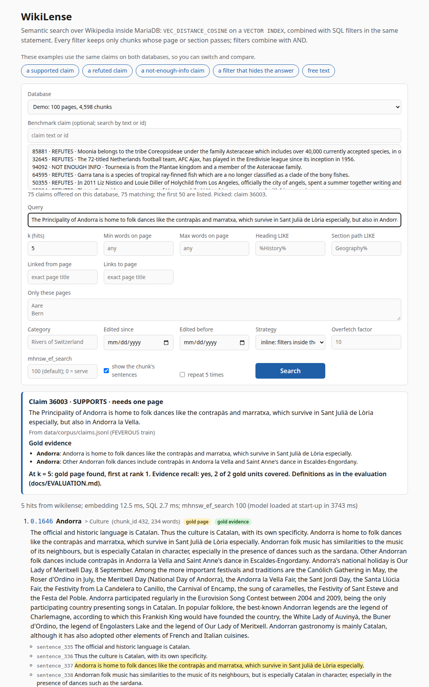

# Examples: every way to query WikiLense

The [README](../README.md) shows one question and its answer. This page has the rest: the
vector index in `EXPLAIN`, the four metadata filters in one statement, the other filters, the
full-text hybrid, the join back to sentences, every option, the web page and its API, and the
SQL file that needs no Python. Every block is the output of the command above it on the
committed corpus; where a block is shortened, the text says so.

The commands are written as `wikilense ...`. That works after `source .venv/bin/activate`; without
it, type `.venv/bin/wikilense ...`.

`wikilense query` embeds the text, runs one SQL statement and prints the hits with their distance,
page title, section path and text. `--explain` prints the statement, its parameters and the
`EXPLAIN` rows.

```
$ wikilense query "Which river rises and ends entirely within Switzerland?" --k 3 --explain
 1. 0.3091  Aare  [chunk_id 1, 127 words]
    The Aare (German: [ˈaːrə]) or Aar (German: [aːɐ̯] (listen)) is a tributary of the High Rhine and
    the longest river that both rises and ends entirely within Switzerland. ...
 2. 0.3593  Aare > Course  [chunk_id 4, 158 words]
 3. 0.3620  Aare > Course  [chunk_id 3, 228 words]
SQL:
    SELECT chunk.chunk_id, chunk.page_id, page.title, section.path AS section_path, chunk.ordinal AS
    chunk_ordinal, chunk.n_words, VEC_DISTANCE_COSINE(chunk.embedding, %s) AS distance, chunk.text
    FROM chunk STRAIGHT_JOIN page ON page.page_id = chunk.page_id STRAIGHT_JOIN section ON
    section.section_id = chunk.section_id ORDER BY VEC_DISTANCE_COSINE(chunk.embedding, %s) LIMIT %s
parameters: <vector[384]>, <vector[384]>, 3
EXPLAIN:
    id  select_type  table    type    possible_keys                           key        key_len  ref                         rows  Extra
    1   SIMPLE       chunk    index   uq_chunk_page_ordinal,ix_chunk_section  embedding  1538     NULL                        3
    1   SIMPLE       page     eq_ref  PRIMARY                                 PRIMARY    4        wikilense.chunk.page_id     1
    1   SIMPLE       section  eq_ref  PRIMARY                                 PRIMARY    4        wikilense.chunk.section_id  1
3 hits; model load 4316 ms, embedding 5.8 ms, SQL 4.5 ms (BAAI/bge-small-en-v1.5 on cuda, strategy inline, ef_search 100)
```

The vector index is the `key` of the first row; `page` and `section` are joined by primary key.

The model loads once per process, so the web server pays for it once, at start-up. The CLI's SQL time
is one sample and includes the `mhnsw_ef_search` session round trips. The harness numbers under
[Evaluation](EVALUATION.md) exclude them.

This query combines the four metadata predicates in one statement. It asks for pages in a category,
longer than 1,000 words, edited since a date and linked from another page:

```
$ wikilense query "independence from the Soviet Union" --k 3 \
    --category "Member states of the United Nations" --min-words 1000 \
    --edited-since 2020-12-01 --linked-from Asia --explain
 1. 0.2522  Azerbaijan > History > Independence  [chunk_id 1145, 224 words]
    Following the politics of glasnost, initiated by Mikhail Gorbachev, civil unrest and ethnic
    strife grew in various regions of the Soviet Union, including Nagorno-Karabakh, ...
 2. 0.3012  Azerbaijan > History > Contemporary history  [chunk_id 1143, 226 words]
 3. 0.3087  Kazakhstan  [chunk_id 3693, 220 words]
SQL:
    ... FROM chunk STRAIGHT_JOIN page ON page.page_id = chunk.page_id STRAIGHT_JOIN section ON
    section.section_id = chunk.section_id STRAIGHT_JOIN (SELECT DISTINCT link.to_page_id AS page_id
    FROM link JOIN page AS src ON src.page_id = link.from_page_id WHERE src.title = %s AND
    link.to_page_id IS NOT NULL) AS linked ON linked.page_id = chunk.page_id STRAIGHT_JOIN (SELECT
    DISTINCT page_category.page_id FROM page_category JOIN category ON category.category_id =
    page_category.category_id WHERE category.name = %s) AS in_category ON in_category.page_id =
    chunk.page_id WHERE page.n_words >= %s AND page.last_edited >= %s ORDER BY
    VEC_DISTANCE_COSINE(chunk.embedding, %s) LIMIT %s
parameters: <vector[384]>, 'Asia', 'Member states of the United Nations', 1000, datetime.datetime(2020, 12, 1, 0, 0), <vector[384]>, 3
EXPLAIN:
    id  select_type  table          type    key                        rows  Extra
    1   PRIMARY      chunk          index   embedding                  3
    1   PRIMARY      page           eq_ref  PRIMARY                    1     Using where
    1   PRIMARY      section        eq_ref  PRIMARY                    1
    1   PRIMARY      <derived2>     ref     key0                       1
    1   PRIMARY      <derived3>     ref     key0                       1
    3   DERIVED      category       const   uq_category_name           1     Using index
    3   DERIVED      page_category  ref     ix_page_category_category  10    Using where; Using index
    2   DERIVED      src            const   uq_page_title              1     Using index
    2   DERIVED      link           range   ix_link_to_page            373   Using index condition; ...
3 hits; model load 4679 ms, embedding 5.1 ms, SQL 4.3 ms (BAAI/bge-small-en-v1.5 on cuda, strategy inline, ef_search 100)
```

(The EXPLAIN is trimmed to the relevant columns.) The vector index drives the scan: `chunk` is read
through `embedding`, ahead of everything else. Length and edit date are checked on the
`page` row (`Using where`). The link and category filters are two small materialised tables
(`<derived2>`, `<derived3>`), each looked up by `page_id`. The category name resolves through its
unique index (`const`), and the pages of that category through `ix_page_category_category`.

The first query below has a predicate on the section heading, the second one on the link graph:

```
$ wikilense query "Roman settlement and medieval castle" --k 3 --heading '%History%'
 1. 0.3490  Lincoln, England > History > Roman history: Lindum Colonia  [chunk_id 3306, 208 words]
 2. 0.3500  Andorra > History > Prehistory  [chunk_id 388, 209 words]

$ wikilense query "football club league titles" --k 3 --linked-from "AFC Ajax"
 1. 0.2935  Juventus F.C. > Honours  [chunk_id 4074, 214 words]
```

Sometimes a filter is what finds the answer. Asked without one, the question below gets three
passages from the page on Alexander the Great, and none of them names a country. The question says
"UN member state", so `--category` can say it too. With it, all three hits are from Afghanistan,
whose text says that Alexander invaded the region. The hit texts are cut here, after their first
lines:

```
$ wikilense query "Which UN member state did Alexander the Great invade?" --k 3
 1. 0.2536  Alexander the Great  [chunk_id 265, 235 words]
 2. 0.2775  Alexander the Great  [chunk_id 266, 190 words]
 3. 0.3091  Alexander the Great > Conquest of the Persian Empire > Asia Minor  [chunk_id 283, 234 words]

$ wikilense query "Which UN member state did Alexander the Great invade?" --k 3 \
    --category "Member states of the United Nations"
 1. 0.3365  Afghanistan  [chunk_id 924, 223 words]
    The region, then known as "Ariana", fell to Achaemenid Persians in the 6th century BCE, who
    conquered the areas to their east as far as the Indus River. Alexander the Great invaded the
    region in the 4th century BCE, ...
 2. 0.3630  Afghanistan > History > Prehistory and antiquity > Zoroastrianism and Hellenic era  [chunk_id 931, 224 words]
 3. 0.3718  Afghanistan > History  [chunk_id 928, 192 words]
```

The same search also shows why the filter belongs inside the statement.
- The category keeps 695 of the 4,598 chunks (10 of the 100 pages).
- The 14 chunks nearest the question all belong to Alexander the Great. Afghanistan's three chunks
  are at exact ranks 15, 24 and 30.
- The bounded strategy `overfetch` takes the index's first `k × overfetch` rows and filters them
  afterwards. So it comes back short until that list reaches rank 30, and when it finds nothing it
  says only `no hits`.
- `inline`, the default, puts the filter in the statement and fills all three rows.

```
$ wikilense query "Which UN member state did Alexander the Great invade?" --k 3 \
    --category "Member states of the United Nations" --strategy overfetch --overfetch 3
no hits
```

| strategy | rows of the 3 asked for |
|---|---|
| `overfetch 1`, `2` and `3` (3, 6 and 9 rows from the index) | 0 |
| `overfetch 5` (15 rows) | 1 |
| `overfetch 10` (30 rows) | 3 |
| `inline` | 3 |

[VECTOR_INDEX.md](VECTOR_INDEX.md#what-we-measured) has the same comparison over 3,000 claims,
with what each strategy costs.

The hybrid strategy fuses the vector ranking with a `FULLTEXT` `MATCH ... AGAINST` ranking by
reciprocal rank fusion, in one statement with three CTEs (the vector list, the full-text list and
their fusion):

```
$ wikilense query "Coppa Italia finals won" --k 3 --strategy rrf
 1. 0.2217  Juventus F.C. > History > Historic four consecutive doubles ... [chunk_id 4054, 236 words, rrf score 0.0323]
```

The join back to the sentences a chunk was built from (`--sentences`) is how the evaluation matches
chunks to FEVEROUS evidence ids:

```
$ wikilense query "Aare hydroelectric plants" --k 1 --sentences
 1. 0.2491  Aare  [chunk_id 1, 127 words]
    sentences (chunk_sentence -> sentence, page order):
        sentence_2  The Aare (German: [ˈaːrə]) or Aar (German: [aːɐ̯] (listen)) is a tributary of ...
        sentence_3  Its total length from its source to its junction with the Rhine comprises about ...
```

All options:
- Filters: `--category NAME` (exact name, no "Category:"); `--edited-since` /
  `--edited-before YYYY-MM-DD` (UTC); `--min-words` / `--max-words` (page length); `--linked-from` /
  `--links-to TITLE`; `--heading` / `--path` (SQL `LIKE` patterns); `--title TITLE` (repeatable,
  exact titles).
- Search: `--strategy inline|overfetch|none|rrf`, `--overfetch N`, and `--ef-search N` (0 keeps the
  server value).
- Output: `--json` for scripts.

`wikilense serve` (or `make serve`) starts a web page with the same query and filters. The links
below point to your own machine, so they work only once the page is running at
http://127.0.0.1:8000.

- A free-text search is a question typed into the box. A note under the box says what such a search
  can and cannot tell: there is no answer key, so the page cannot know whether a hit is right, and
  the hits are the closest passages among this database's pages, not all of Wikipedia. "Which pages
  does it hold?" lists them.
- The claim picker next to the query box searches the FEVEROUS claims by text or id. Picking one
  fills the query with the claim's text, runs the search and shows the claim's label, whether it
  needs one page or several, and its gold evidence (page title and sentence text, read from the
  database). Each hit on a gold page is marked "gold page", and each chunk that holds a gold
  sentence "gold evidence"; with "show the chunk's sentences" on, the gold sentences are
  highlighted. A summary line gives the claim's result at the chosen k by the evaluation's
  definitions: whether a gold page is in the hits and the rank of the first, and whether the
  evidence is fully covered (evidence recall), with the gold units covered out of how many. Evidence
  in a table is shown as "evidence in a table (not indexed)". Editing the query drops the claim.
- A claim file belongs to a database when the database's `claim` table holds exactly its claim ids:
  `data/corpus/claims.jsonl` for the demo, `data/scaled/claims_3000.jsonl` for S1. The picker then
  offers every claim of either file whose gold pages are all in that database and whose gold
  sentences all resolve there: 75 on the demo (8 of them are also among the 3,000) and 3,032 on S1
  (the 3,000 and 32 more demo claims). Without a matching file the picker is hidden.
  [DESIGN.md](DESIGN.md#cli-and-web-clipy-webpy) has the details.
- The database selector offers the demo database and, when it is loaded, the scaled database S1
  (`wikilense_s1`; [SETUP.md](SETUP.md#get-the-scaled-database-s1) has the download). The labels
  give each one's size, read from the database. A database loaded or ingested again while the page
  is running, such as S1 after `make load-s1` in another terminal, shows up at the next reload,
  without restarting `make serve`.
- "Repeat 5 times" runs the search statement five times on the same connection and shows the median
  SQL time and the range, because a single timing on a laptop can drift by tens of percent. The
  query is embedded once.
- Each example button fills the whole form and runs it. The row has a supported, a refuted and a
  not-enough-info claim, the supported claim with a filter that hides its gold page, a free-text
  question, and, on S1 only, a claim whose evidence needs two pages. The first five are the same on
  both databases, so you can switch and compare.
- "Copy the prompt", under the results of any search, shows the LLM fact-check's prompt with the
  statement (or the picked claim) and the first 5 passages as one text to paste into a chatbot,
  with a "Copy" button. It needs no key and makes no model call. Its one change from the
  experiment's prompt is in [LLM_EXTENSION.md](LLM_EXTENSION.md#14-on-the-web-page).

Every search goes into the address bar, so a link reproduces it. For example
[`/?database=wikilense&claim_id=36003&sentences=1`](http://127.0.0.1:8000/?database=wikilense&claim_id=36003&sentences=1)
is the screenshot below (the supported example on the demo), and
[`/?q=independence+from+the+Soviet+Union&k=3&category=Member+states+of+the+United+Nations&min_words=1000&edited_since=2020-12-01&linked_from=Asia`](http://127.0.0.1:8000/?q=independence+from+the+Soviet+Union&k=3&category=Member+states+of+the+United+Nations&min_words=1000&edited_since=2020-12-01&linked_from=Asia)
uses the four metadata filters. A link with a claim or a database that the server does not offer
shows a message and runs nothing.

The API behind the page, `GET /api/search`, takes the same parameters and returns `hits`, the `sql`
that ran, its `explain` rows, the effective `ef_search` and `timing_ms`. With `claim_id` it also
returns `claim`, `marks` (one per hit) and `summary`; these are computed after the timed statement,
so `sql` and `timing_ms.sql` are the search alone. With `repeat` it returns `repeat` (every run's
time, the median and the range), with `database` the database that answered. `GET /api/databases`,
`/api/claims` and `/api/pages` list the choices, the claims and the page titles. `GET /api/prompt`
takes the search's parameters (without `sentences` and `repeat`) and returns the copy box's text.
A search that runs past `WIKILENSE_STATEMENT_SECONDS` (5 s) is stopped by MariaDB and answered
with 504 and a one-sentence message. Swagger is enabled
at `/docs`, so the API can be tried from the browser. (The Swagger page is FastAPI's default and
loads its script from a CDN, so it needs a network connection; the search page itself has no
external assets.)



[sql/examples.sql](../sql/examples.sql) has ten worked examples for the `mariadb` client alone (no
Python, no model). They include the four-filter statement with its `EXPLAIN`, a page's categories
and edit date, and a transaction that shows the vector index following `ROLLBACK`. A test runs every
statement of the file against the schema. `make examples` runs the file through the `mariadb`
client inside the container and prints each result as a table; it leaves the database as it was.
