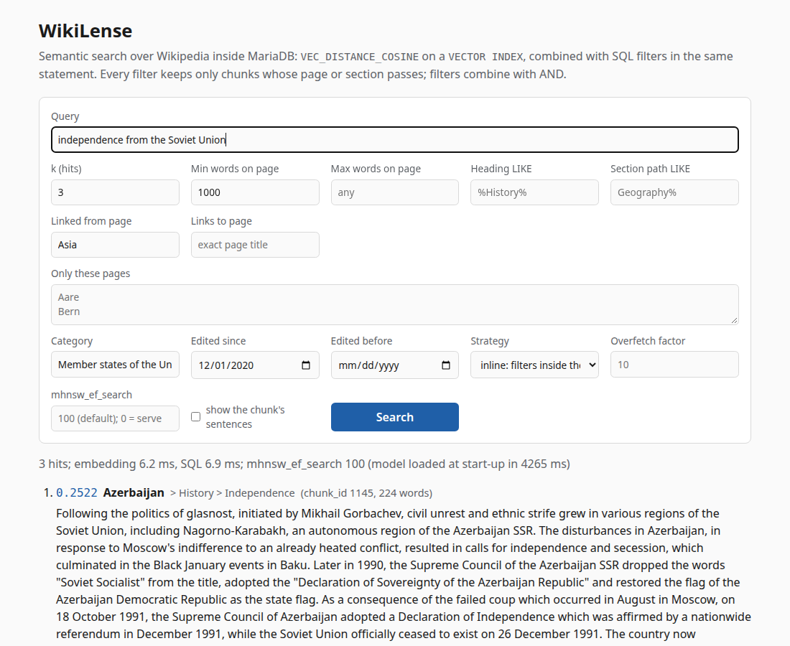

# Examples: every way to query WikiLense

The [README](../README.md) shows one question and its answer. This page has the rest: the
vector index in `EXPLAIN`, the brief's four filters in one statement, the other filters, the
full-text hybrid, the join back to sentences, every option, the web page and its API, and the
SQL file that needs no Python. Every block is the output of the command above it on the
committed corpus; where a block is shortened, the text says so.

The commands are written as `wikilense ...`. That works after `source .venv/bin/activate`; without
it, type `.venv/bin/wikilense ...`.

`wikilense query` embeds the text, runs one SQL statement and prints the hits with their distance,
page title, section path and text. `--explain` prints the statement, its parameters and the
`EXPLAIN` rows.

```
$ wikilense query "Which river rises and ends entirely within Switzerland?" --k 3 --explain
 1. 0.3091  Aare  [chunk_id 1, 127 words]
    The Aare (German: [ˈaːrə]) or Aar (German: [aːɐ̯] (listen)) is a tributary of the High Rhine and
    the longest river that both rises and ends entirely within Switzerland. ...
 2. 0.3593  Aare > Course  [chunk_id 4, 158 words]
 3. 0.3620  Aare > Course  [chunk_id 3, 228 words]
SQL:
    SELECT chunk.chunk_id, chunk.page_id, page.title, section.path AS section_path, chunk.ordinal AS
    chunk_ordinal, chunk.n_words, VEC_DISTANCE_COSINE(chunk.embedding, %s) AS distance, chunk.text
    FROM chunk STRAIGHT_JOIN page ON page.page_id = chunk.page_id STRAIGHT_JOIN section ON
    section.section_id = chunk.section_id ORDER BY VEC_DISTANCE_COSINE(chunk.embedding, %s) LIMIT %s
parameters: <vector[384]>, <vector[384]>, 3
EXPLAIN:
    id  select_type  table    type    possible_keys                           key        key_len  ref                         rows  Extra
    1   SIMPLE       chunk    index   uq_chunk_page_ordinal,ix_chunk_section  embedding  1538     NULL                        3
    1   SIMPLE       page     eq_ref  PRIMARY                                 PRIMARY    4        wikilense.chunk.page_id     1
    1   SIMPLE       section  eq_ref  PRIMARY                                 PRIMARY    4        wikilense.chunk.section_id  1
3 hits; model load 4316 ms, embedding 5.8 ms, SQL 4.5 ms (BAAI/bge-small-en-v1.5 on cuda, strategy inline, ef_search 100)
```

The vector index is the `key` of the first row; `page` and `section` are joined by primary key.

The model load happens once per process; the web server pays it once at start-up. The CLI's SQL time
is one sample and includes the `mhnsw_ef_search` session round trips. The harness numbers under
[Evaluation](EVALUATION.md) exclude them.

This query combines the brief's four predicates in one statement. It asks for pages in a category,
longer than 1,000 words, edited since a date and linked from another page:

```
$ wikilense query "independence from the Soviet Union" --k 3 \
    --category "Member states of the United Nations" --min-words 1000 \
    --edited-since 2020-12-01 --linked-from Asia --explain
 1. 0.2522  Azerbaijan > History > Independence  [chunk_id 1145, 224 words]
    Following the politics of glasnost, initiated by Mikhail Gorbachev, civil unrest and ethnic
    strife grew in various regions of the Soviet Union, including Nagorno-Karabakh, ...
 2. 0.3012  Azerbaijan > History > Contemporary history  [chunk_id 1143, 226 words]
 3. 0.3087  Kazakhstan  [chunk_id 3693, 220 words]
SQL:
    ... FROM chunk STRAIGHT_JOIN page ON page.page_id = chunk.page_id STRAIGHT_JOIN section ON
    section.section_id = chunk.section_id STRAIGHT_JOIN (SELECT DISTINCT link.to_page_id AS page_id
    FROM link JOIN page AS src ON src.page_id = link.from_page_id WHERE src.title = %s AND
    link.to_page_id IS NOT NULL) AS linked ON linked.page_id = chunk.page_id STRAIGHT_JOIN (SELECT
    DISTINCT page_category.page_id FROM page_category JOIN category ON category.category_id =
    page_category.category_id WHERE category.name = %s) AS in_category ON in_category.page_id =
    chunk.page_id WHERE page.n_words >= %s AND page.last_edited >= %s ORDER BY
    VEC_DISTANCE_COSINE(chunk.embedding, %s) LIMIT %s
parameters: <vector[384]>, 'Asia', 'Member states of the United Nations', 1000, datetime.datetime(2020, 12, 1, 0, 0), <vector[384]>, 3
EXPLAIN:
    id  select_type  table          type    key                        rows  Extra
    1   PRIMARY      chunk          index   embedding                  3
    1   PRIMARY      page           eq_ref  PRIMARY                    1     Using where
    1   PRIMARY      section        eq_ref  PRIMARY                    1
    1   PRIMARY      <derived2>     ref     key0                       1
    1   PRIMARY      <derived3>     ref     key0                       1
    3   DERIVED      category       const   uq_category_name           1     Using index
    3   DERIVED      page_category  ref     ix_page_category_category  10    Using where; Using index
    2   DERIVED      src            const   uq_page_title              1     Using index
    2   DERIVED      link           range   ix_link_to_page            373   Using index condition; ...
3 hits; model load 4679 ms, embedding 5.1 ms, SQL 4.3 ms (BAAI/bge-small-en-v1.5 on cuda, strategy inline, ef_search 100)
```

(The EXPLAIN is trimmed to the columns that matter here.) The vector index drives the scan: `chunk`
is read through `embedding`, ahead of everything else. Length and edit date are checked on the
`page` row (`Using where`). The link and category filters are two small materialised tables
(`<derived2>`, `<derived3>`), each looked up by `page_id`. The category name resolves through its
unique index (`const`), and the pages of that category through `ix_page_category_category`.

The first query below has a predicate on the section heading, the second one on the link graph:

```
$ wikilense query "Roman settlement and medieval castle" --k 3 --heading '%History%'
 1. 0.3490  Lincoln, England > History > Roman history: Lindum Colonia  [chunk_id 3306, 208 words]
 2. 0.3500  Andorra > History > Prehistory  [chunk_id 388, 209 words]

$ wikilense query "football club league titles" --k 3 --linked-from "AFC Ajax"
 1. 0.2935  Juventus F.C. > Honours  [chunk_id 4074, 214 words]
```

The hybrid strategy fuses the vector ranking with a `FULLTEXT` `MATCH ... AGAINST` ranking by
reciprocal rank fusion, in one statement with three CTEs (the vector list, the full-text list and
their fusion):

```
$ wikilense query "Coppa Italia finals won" --k 3 --strategy rrf
 1. 0.2217  Juventus F.C. > History > Historic four consecutive doubles ... [chunk_id 4054, 236 words, rrf score 0.0323]
```

The join back to the sentences a chunk was built from (`--sentences`) is how the evaluation matches
chunks to FEVEROUS evidence ids:

```
$ wikilense query "Aare hydroelectric plants" --k 1 --sentences
 1. 0.2491  Aare  [chunk_id 1, 127 words]
    sentences (chunk_sentence -> sentence, page order):
        sentence_2  The Aare (German: [ˈaːrə]) or Aar (German: [aːɐ̯] (listen)) is a tributary of ...
        sentence_3  Its total length from its source to its junction with the Rhine comprises about ...
```

All options:
- Filters: `--category NAME` (exact name, no "Category:"); `--edited-since` /
  `--edited-before YYYY-MM-DD` (UTC); `--min-words` / `--max-words` (page length); `--linked-from` /
  `--links-to TITLE`; `--heading` / `--path` (SQL `LIKE` patterns); `--title TITLE` (repeatable,
  exact titles).
- Search: `--strategy inline|overfetch|none|rrf`, `--overfetch N`, and `--ef-search N` (0 keeps the
  server value).
- Output: `--json` for scripts.

`wikilense serve` starts a web page with the same query and filters. Searches can be shared as
links: a link with the form's parameters fills the form and runs the search. The screenshot below is
`http://127.0.0.1:8000/?q=independence+from+the+Soviet+Union&k=3&category=Member+states+of+the+United+Nations&min_words=1000&edited_since=2020-12-01&linked_from=Asia`.
The API behind the page, `GET /api/search`, takes the same parameters and returns `hits`, the `sql`
that ran, its `explain` rows, the effective `ef_search` and `timing_ms`. Swagger is enabled at
`/docs`, so the API can be tried from the browser. (The Swagger page is FastAPI's default and loads
its script from a CDN, so it needs a network connection; the search page itself has no external
assets.)



[sql/examples.sql](../sql/examples.sql) has ten worked statements for the `mariadb` client alone (no
Python, no model). They include the four-filter statement with its `EXPLAIN`, a page's categories
and edit date, and a transaction that shows the vector index following `ROLLBACK`. A test runs every
statement of the file against the schema. `make examples` runs the file through the `mariadb`
client inside the container and prints each result as a table; it leaves the database as it was.
