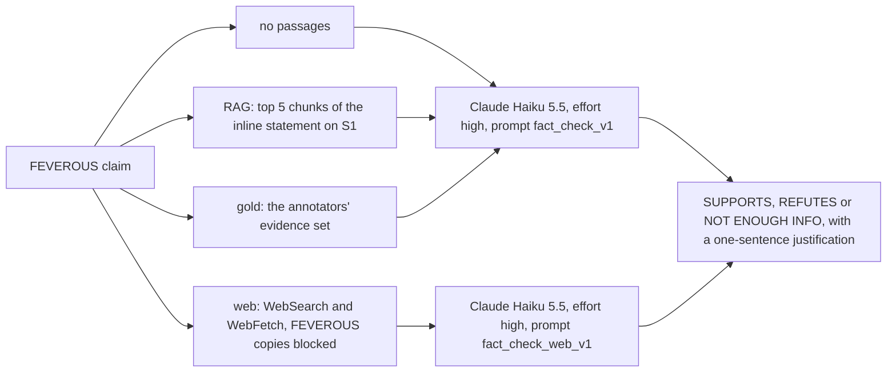
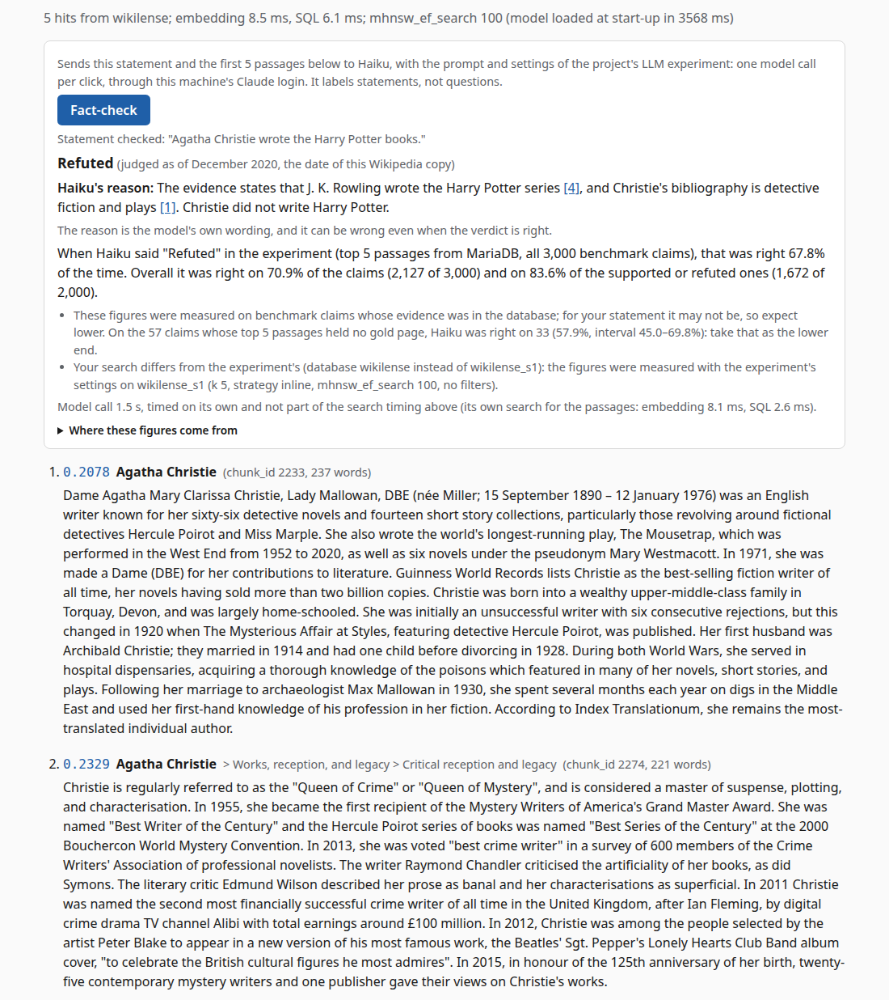

# The LLM fact-checker extension

The database part of WikiLense measures retrieval: does the vector search find the gold evidence
of a FEVEROUS claim? This extension asks the next question: does a language model judge the
claim better once it reads what the search found? Every number below comes from
[results/llm/](../results/llm/), written by `scripts/llm_results.py`
([LLM_RESULTS.md](../results/llm/LLM_RESULTS.md) has every table, `llm_results.json` every value).

## 1. The question

Does a small model, Claude Haiku 5.5, get better at fact-checking with RAG, the top 5 chunks of
one SQL statement? And does RAG help more than letting the model search the web, as a person
would? Retrieval quality itself is covered by the database part ([EVALUATION.md](EVALUATION.md)).

## 2. The setup

The same 3,000 claims ([data/scaled/claims_3000.jsonl](../data/scaled/claims_3000.jsonl): 1,000
per label, 700 of each on one page and 300 needing two or more) were judged four ways:



- **The model and the route.** `claude-haiku-5-5` at effort high, through the Claude Code CLI
  (2.1.322) on a Claude subscription, five calls at a time, one call per claim and condition
  (`wikilense/llm/runner.py`). The answer is forced into a JSON schema with two fields, `label`
  (one of the three labels) and `justification`; only the label is scored.
- **The prompt** of the three passage conditions,
  [`fact_check_v1/system.txt`](../wikilense/llm/prompts/fact_check_v1/system.txt), word for word:

  ```text
  Label the CLAIM SUPPORTS, REFUTES or NOT ENOUGH INFO as of December 2020, the date of the benchmark's Wikipedia snapshot, so later events do not count.

  When EVIDENCE is given, start from it: numbered Wikipedia passages retrieved for this claim, so some may be off-topic and a claim may need several together. Add your own knowledge where the passages fall short.

  - SUPPORTS: every part of the claim is confirmed.
  - REFUTES: at least one part is contradicted.
  - NOT ENOUGH INFO: nothing is contradicted, but some part stays unconfirmed. A fact no source mentions is unconfirmed, not false; a guess would turn that gap into a wrong label. A claim more specific than its source (a month where the source gives only a year) is unconfirmed too.

  Answer with one StructuredOutput call: "result" holds "label" (exactly one of the three) and "justification" (one sentence, at most 30 words: the deciding fact and the passages or sources used, such as [2]). No other text.
  ```

  The user turn is `EVIDENCE:` followed by the numbered passages, then `CLAIM:` and the claim;
  without passages it reads `EVIDENCE: (none given)`. The web prompt,
  [`fact_check_web_v1/system.txt`](../wikilense/llm/prompts/fact_check_web_v1/system.txt), replaces
  the second paragraph with "You can search the web and open pages. Use them to check the claim
  where your own knowledge falls short; a claim may need several facts checked." and ends the
  justification rule with "the sources used, such as a page title"; its user turn is the claim
  alone.
- **Three facts about the prompt.** It lets the model add its own knowledge where the passages
  fall short, because real retrieval will not always find the answer. It asks for the state as of
  December 2020, the date of FEVEROUS's Wikipedia, so later events do not count. And it is the same
  for gold: "gold" means the annotators' evidence plus the model's own knowledge, so it is a
  reference point, not a ceiling.
- **The passages** of RAG come from the `inline` statement (the joined statement that
  `wikilense query` runs) on S1, 132,359 chunks, with k = 5 and `mhnsw_ef_search` 100, each chunk
  headed by its page title and section path. Retrieval was cached once per claim, so every run
  saw the same passages.
- **What the web condition blocks.** Claude Code's WebSearch and WebFetch tools are allowed, but
  WebFetch may not open the hosts in
  [`wikilense/llm/web_deny_hosts.txt`](../wikilense/llm/web_deny_hosts.txt): fever.ai, zenodo.org,
  github.com and its content hosts, huggingface.co and hf.co, kaggle.com and paperswithcode.com,
  with their subdomains. FEVEROUS's claims and labels are published there, and reading the answer
  key would not be fact-checking.
- **What is tested** is open-world fact-checking: the truth is not limited to Wikipedia, and the
  model may use what it knows. Fact-checking only against your own data, where the verdict must
  come from the passages alone, is further work.

## 3. Three-class results

Accuracy is the share of claims whose answer equals the FEVEROUS label; the intervals are 95%
Wilson intervals, the macro F1 interval is a paired bootstrap (10,000 resamples, seed 20261120).

| condition | accuracy (3,000 claims) | macro F1 | recall SUPPORTS / REFUTES / NOT ENOUGH INFO | NOT ENOUGH INFO answers, right |
|---|---|---|---|---|
| no passages | 45.2% (43.4 to 47.0) | 44.7 (42.9 to 46.5) | 30.5 / 40.0 / 65.1 | 1,765, 36.9% right |
| web search | 61.3% (59.5 to 63.0) | 56.8 (55.1 to 58.5) | 80.0 / 83.8 / 20.1 | 308, 65.3% right |
| RAG | 70.9% (69.2 to 72.5) | 69.6 (68.0 to 71.2) | 85.0 / 82.2 / 45.5 | 606, 75.1% right |
| gold | 72.9% (71.2 to 74.4) | 72.1 (70.5 to 73.7) | 85.7 / 80.0 / 52.9 | 755, 70.1% right |

Claim by claim (McNemar's exact test; the interval of a paired difference is
(b − c)/n ± 1.96 · √(b + c − (b − c)²/n) / n, with b and c the claims only one of the two got
right), RAG is ahead of web search by 9.6 points (95% interval 8.0 to 11.2) and gold is ahead of
RAG by 2.0 points (0.7 to 3.3). Over no passages, RAG gains 771 right claims and gold 830, so RAG
recovers 92.9% of what the gold evidence adds.

Confusion matrices (rows: the FEVEROUS label; each cell: answered SUPPORTS / REFUTES / NOT ENOUGH
INFO, of 1,000 claims):

| label | no passages | web search | RAG | gold |
|---|---|---|---|---|
| SUPPORTS | 305 / 85 / 610 | 800 / 148 / 52 | 850 / 99 / 51 | 857 / 80 / 63 |
| REFUTES | 96 / 400 / 504 | 107 / 838 / 55 | 78 / 822 / 100 | 37 / 800 / 163 |
| NOT ENOUGH INFO | 186 / 163 / 651 | 411 / 388 / 201 | 254 / 291 / 455 | 226 / 245 / 529 |

The six groups (accuracy):

| group | claims | no passages | web search | RAG | gold |
|---|---|---|---|---|---|
| SUPPORTS, one article | 700 | 27.7% | 80.3% | 84.7% | 85.1% |
| SUPPORTS, two or more | 300 | 37.0% | 79.3% | 85.7% | 87.0% |
| REFUTES, one article | 700 | 39.3% | 88.3% | 86.1% | 82.7% |
| REFUTES, two or more | 300 | 41.7% | 73.3% | 73.0% | 73.7% |
| NOT ENOUGH INFO, one article | 700 | 67.6% | 20.3% | 47.4% | 55.3% |
| NOT ENOUGH INFO, two or more | 300 | 59.3% | 19.7% | 41.0% | 47.3% |

**Reweighted to FEVEROUS's own mix.** A third of our claims are NOT ENOUGH INFO, against 3.5% of
FEVEROUS's. With the weights of the database part
([results/scaled/breakdown/breakdown.json](../results/scaled/breakdown/breakdown.json); the sum
over the six groups of weight × the group's accuracy, intervals by paired bootstrap):

| weights | no passages | web search | RAG | gold |
|---|---|---|---|---|
| every FEVEROUS train + dev claim | 34.9% (32.8 to 37.0) | 80.9% (79.2 to 82.6) | 83.8% (82.2 to 85.4) | 83.2% (81.5 to 84.8) |
| claims with a text-only evidence set | 35.4% (33.3 to 37.6) | 81.0% (79.3 to 82.6) | 83.7% (82.0 to 85.2) | 82.9% (81.2 to 84.5) |

With the first weights RAG is ahead of web search by 2.9 points (1.3 to 4.5), and RAG and gold
are level (0.6, −0.7 to 2.0).

**NOT ENOUGH INFO answers.** This is an interpretation; the cause was not tested. Without passages
Haiku answers NOT ENOUGH INFO most often (1,765 times), and those answers are right 36.9% of the
time, close to the 33.3% that chance gives on this balanced set. That fits a model that is unsure
and hedges, and it makes NOT ENOUGH INFO the label it recalls best there (65.1%). With web search
it gives this answer least often (308 times) and picks a side on 79.9% of the NOT ENOUGH INFO
claims. In every condition except no passages, NOT ENOUGH INFO is the label with the lowest
recall: 20.1% with web search, 45.5% with RAG and 52.9% with gold. Even with the gold evidence,
Haiku picks a side on 47.1% of the NOT ENOUGH INFO claims.

## 4. Why NOT ENOUGH INFO is a weak label here

FEVEROUS's annotators worked under rules that our prompt does not share (Aly et al., 2021,
[arXiv 2106.05707v3](https://arxiv.org/abs/2106.05707), appendix 7.10.1, the claim-verification
guidelines, and section 3.1.2):

- "However, an entire annotation for a single claim should not surpass 10 Minutes. If it does,
  keep the already annotated evidence and submit it with the verdict NotEnoughInformation."
- "If you have doubt regarding your assessment go with NEI, e.g. … it is NEI."
- "You must apply common-sense reasoning to the evidence you read but avoid applying your own
  (world) knowledge." The next sentences make one exception: "very general world knowledge"
  that "cannot be found on Wikipedia" may be used.
- A claim is NOT ENOUGH INFO "if not enough information can be found on Wikipedia to arrive at one
  of the two other verdicts".

So the label means "the annotator did not settle it from Wikipedia under these rules", not "the
answer does not exist". A model that is allowed outside knowledge can be marked wrong for a
correct verdict, when it finds the answer outside Wikipedia or finds what the annotator missed.

**The audit.** On some claims labelled NOT ENOUGH INFO, Haiku answered SUPPORTS or REFUTES, and
those answers count as wrong. Claude Opus 5.5 agents reviewed 100 of them (40 gold, 40 RAG, 20 no
passages, drawn at random with a fixed seed) and named the main reason for each. In 16 of the 40
gold cases and 16 of the 40 RAG cases, that reason was a doubtful label: the text Haiku saw does
settle the claim, the way Haiku answered. In those cases Haiku may have been right and the label
wrong. (For the no-passage cases the agents judged from the annotators' evidence: 4 of 20.) Two
agents rated each case without seeing each other's ratings and agreed on the main reason in 94 of
100. A third agent settled those 6 cases and 3 more where they disagreed on another rating. This
is a sample, not a count over all claims, and no person has checked the ratings, so how often a
person would agree with them is not known.

## 5. The supported and refuted claims

**Why NOT ENOUGH INFO is dropped here.** Because of the label problem above, the comparison
between conditions uses the 2,000 claims whose label is SUPPORTS or REFUTES. The annotators found
evidence that settles these claims, so a NOT ENOUGH INFO answer counts as wrong, and no claim is
dropped because of the model's answer. This choice was made after seeing the results. It is the
cautious one for RAG: its lead over web search shrinks from 9.6 points on three classes to 1.7
points here.

| condition | accuracy (2,000 claims) | picked a side | right when it picked a side |
|---|---|---|---|
| no passages | 35.3% (33.2 to 37.4) | 44.3% (886) | 79.6% (76.8 to 82.1) |
| web search | 81.9% (80.2 to 83.5) | 94.7% (1,893) | 86.5% (84.9 to 88.0) |
| RAG | 83.6% (81.9 to 85.2) | 92.5% (1,849) | 90.4% (89.0 to 91.7) |
| gold | 82.9% (81.1 to 84.4) | 88.7% (1,774) | 93.4% (92.2 to 94.5) |

Of the three conditions with passages or search, web search picks a side most often and is the
least accurate when it does; gold picks a side least often and is the most accurate. Grading only
the claims where a condition picked a side would reward hedging: no passages would then score
79.6%.

Claim by claim, on the same 2,000 claims (b and c as in section 3; p-values are not corrected for
the six comparisons):

| pair | only the first right (b) | only the second right (c) | difference, points | 95% interval | McNemar p |
|---|---|---|---|---|---|
| RAG vs web search | 145 | 111 | 1.7 | 0.1 to 3.3 | 0.039 |
| RAG vs gold | 102 | 87 | 0.8 | −0.6 to 2.1 | 0.31 |
| gold vs web search | 161 | 142 | 1.0 | −0.8 to 2.7 | 0.30 |
| RAG vs no passages | 998 | 31 | 48.4 | 46.0 to 50.7 | 6.7e-251 |
| gold vs no passages | 989 | 37 | 47.6 | 45.3 to 49.9 | 2.8e-241 |
| web search vs no passages | 976 | 43 | 46.7 | 44.3 to 49.0 | 5.6e-231 |


**How the comparisons are worded.** Two conditions are "level" only where the 95% interval of
their paired difference includes zero; otherwise one is "ahead by X points", with the interval.
The text also says when a gap is smaller than about two rerun standard deviations, the spread
between reruns of the same claims (section 7). For the three close pairs above that is 1.2 to 1.3
points: RAG's lead over web search (1.7) is above it but not by much, and RAG against gold and
gold against web search are below it as well as level.

## 6. F1 per label


On the 2,000 claims a NOT ENOUGH INFO answer lowers recall and counts toward neither label's
precision. On refuted claims web search, RAG and gold are level (F1 84.4, 85.6 and 85.1; every
paired difference includes zero). On supported claims the order is gold, RAG, web search: RAG is
ahead of web search by 4.3 F1 points (2.8 to 5.9) and gold ahead of RAG by 2.3 (1.0 to 3.6).
RAG's edge over web search there comes from recall (85.0 against 80.0) and from precision (91.6
against 88.2), because web search called more refuted claims supported: 107 of the 1,000, against
78 for RAG and 37 for gold. Gold's edge over RAG is precision (95.9 against 91.6), with nearly
the same recall. RAG's 1.7-point lead over web search in accuracy comes from the supported claims:
it gets 850 of them right and web search 800, while on the refuted claims web search is ahead,
838 against 822. Intervals are by paired bootstrap (10,000 resamples, seed 20261121).

## 7. Run-to-run variance

The same model can give a different answer to the same prompt from one run to the next. To
measure how much, every condition ran twice more (r1 and r2) on 450 of the claims: 150 per label,
105 of each on one article and 45 needing two or more, the first claims of each of the six groups
when ordered by the SHA-256 of `repeat450-2026-11-19:<claim id>`. The repeats used the settings,
prompts and CLI binary (2.1.322) of the original runs; a newer CLI was installed by then and
not used. RAG read the same cached passages, and all 3,600 user turns of the repeats are byte
for byte those of the original runs (compared by `user_text_sha256`).

| condition | claims | accuracy: original / r1 / r2 | switched between right and wrong: original–r1 / original–r2 / r1–r2 |
|---|---|---|---|
| no passages | 450 | 48.0 / 44.7 / 46.0% | 10.9 / 10.0 / 8.4% |
| no passages | 300 supported/refuted | 37.0 / 32.7 / 34.3% | 11.0 / 10.7 / 6.3% |
| web search | 450 | 61.6 / 62.7 / 61.8% | 7.8 / 8.7 / 8.9% |
| web search | 300 supported/refuted | 79.0 / 81.3 / 80.7% | 5.7 / 7.0 / 8.0% |
| RAG | 450 | 69.6 / 69.1 / 70.7% | 4.4 / 3.3 / 5.6% |
| RAG | 300 supported/refuted | 83.0 / 82.0 / 83.7% | 3.7 / 2.0 / 5.0% |
| gold | 450 | 72.0 / 72.4 / 72.9% | 8.4 / 5.8 / 7.1% |
| gold | 300 supported/refuted | 83.3 / 80.0 / 82.0% | 6.7 / 3.3 / 5.3% |

Between two runs the label stayed the same on 86.2% to 95.3% of the 450 claims. RAG's answers
changed least (93.3% to 95.3% identical), those without passages most (86.2% to 88.4%).

**The rerun standard deviation.** If a share f of the claims switches between right and wrong from
one run to the next, an accuracy over n claims varies between runs by about √(f / 2n), and a
difference between two conditions by √2 times that. With the switch rates above, one condition's
accuracy varies by 0.2 to 0.4 points over the 3,000 claims and by 0.2 to 0.5 over the 2,000
supported/refuted ones; a difference between two conditions by 0.3 to 0.6 and 0.3 to 0.7 points.

**The original runs against the repeats.** If something had changed between the original runs and
the repeats, the original would differ from both repeats more than they differ from each other.

- For web search, RAG and gold it does not. The original switches against a repeat about as often
  as the repeats do against each other, and of the 18 accuracy differences between two runs of
  these conditions one has an interval that excludes zero: gold on the 300 supported/refuted
  claims, original against r1, 3.3 points (0.4 to 6.2, p 0.041). There r1 is the low run (80.0%
  against 83.3% and 82.0%), and the original is level with r2 (1.3, −0.7 to 3.4).
- No passages is the exception. Its original run scored highest on the sample (48.0% against
  44.7% and 46.0%, and 37.0% against 32.7% and 34.3% on the supported/refuted claims), it switched
  against the repeats more often than they did against each other (10.9% and 10.0% against 8.4%),
  and it is ahead of r1 by 3.3 points (0.3 to 6.4, p 0.044), though level with r2 (2.0, −0.9 to
  4.9). The repeats ran the same CLI binary, so the CLI version does not explain it. Nor can the
  runs tell a change between the runs from chance: 3 of the 16 differences between the original
  and a repeat exclude zero, against none of the 8 between the repeats, with no correction for the
  24 comparisons.
- Either way, no comparison in this document changes: no passages trails every other condition by
  16.1 points or more on three classes and by 46.7 or more on the supported/refuted claims.

**The wording rule.** Its last part (section 5) takes two rerun standard deviations of a
difference, from the larger of the two conditions' SDs over the three pairs of runs: 1.1 to 1.2
points for the comparisons on 3,000 claims and 1.2 to 1.5 for those on 2,000. Every paired
three-class gap in section 3 is larger; the reweighted figures there have no rerun SD of their
own. On the supported/refuted claims, RAG's 1.7-point lead over web search is above two rerun SDs
(1.3) but not by much, and RAG against gold (0.8) and gold against web search (1.0), level
already, are below them (1.2 and 1.3). [LLM_RESULTS.md](../results/llm/LLM_RESULTS.md) has every
pair of runs, the SDs for both claim counts and the accuracy differences between runs.

## 8. Where it fails

- **Claims that need two or more articles.** RAG is right on 72.8% of the one-article claims and
  66.6% of the others (85.4% against 79.3% on the supported/refuted ones). Gold drops in the same
  way (74.4% against 69.3%), so the second article is hard for the model, not only for retrieval.
  On refuted claims that need two or more articles all three of web search, RAG and gold reach
  only 73.0% to 73.7%.
- **Claims where retrieval missed.** For 2,943 of the 3,000 claims (98.1%) a gold page is among the
  five passages; RAG is right on 71.2% of those and on 57.9% of the other 57. On the
  supported/refuted claims the split is sharper: 83.9% against 30.8% (4 of 13). When every page of
  the shown gold set is among the passages (2,534 claims, 84.5%), RAG is right on 71.7%, against
  66.3% when it is not.

## 9. The web condition

- **How it used its tools.** 3,965 searches and 4,265 page fetches over the 3,000 claims, a median
  of 4 turns per call; 3,744 of the fetches opened en.wikipedia.org. 228 claims were answered
  without any tool call, and the deny list stopped 4 fetches.
- **Flagged claims.** An audit of every call's searches, URLs and tool results flagged 35 claims
  that mention FEVEROUS, a host where its data is published, or a label next to the word
  "Verdict"; they are kept in the results.
- **Today's web against December 2020.** On 255 supported/refuted claims web search gave the
  opposite label (148 supported claims answered REFUTES, 107 refuted ones SUPPORTS). Some may be
  facts that changed after 2020, where web search answered for today instead of for December 2020
  as the prompt asks, some may be wrong FEVEROUS labels, and the rest are the model's own errors.
  None was checked against the December 2020 page versions, so the size of each group is not
  known. All 255 count as wrong answers in the results above.

## 10. Cost and time

- **Retrieval's share of a RAG call.** The `inline` statement on S1 takes 27.301 ms at the median
  and the claim embedding 6.07 ms, against 2.3 s for the median RAG call, so the database part is
  1.4% of the time
  ([separate_index.json](../results/scaled/run1/s1/separate_index.json),
  [s1_full_run1.json](../results/scaled/eval/s1_full_run1.json)). Both database times were
  measured with the CPU capped at 50% and the GPU at 2,100 MHz; the embedding time is from the
  GPU, while the RAG run embedded its claims on the CPU.
- **RAG also makes the model faster and cheaper.**

  | condition | median seconds per claim | × RAG | median thinking tokens | prompt tokens, all claims |
  |---|---|---|---|---|
  | no passages | 4.2 | 1.8 | 636 | 5,069,111 |
  | web search | 18.2 | 7.8 | 2,405 | 165,580,936 |
  | RAG | 2.3 | 1.0 | 227 | 9,766,910 |
  | gold | 2.6 | 1.1 | 276 | 5,532,364 |

  With the passages Haiku decides with less thinking (227 thinking tokens at the median against
  636 without), and web search reads far more prompt tokens than RAG (165.6 against 9.8
  million) and takes 7.8 times as long.
- **The usage window.** By the subscription's own readings, the no-passage and gold run (6,000
  calls) used 0.11 of a five-hour window, RAG 0.05 and web search 0.60, spread over three
  windows. The readings cover the whole account.
- **These are observed medians, not a controlled timing.** The calls went through the
  subscription to Anthropic's servers, five at a time, so their times depend on server load and
  the network. Only the database times are controlled measurements.

## 11. Contamination

- **Why it matters here.** FEVEROUS was published in 2021, and its claims, labels and Wikipedia
  pages are public, so they may be in Haiku's training data; Anthropic gives Haiku 5.5 a training
  data cutoff of June 2026
  ([models overview](https://platform.claude.com/docs/en/about-claude/models/overview)). This
  applies to all four conditions, because the same model judges in each.
- **Two things to keep apart.** Having seen the benchmark's claim and label pairs is
  contamination. Knowing the Wikipedia facts is world knowledge, which the prompt allows.
- **What is not known.** Haiku's training data is not published, so we make no claim about what
  it contains.
- **What the runs show.** With no passages, Haiku scores 45.2% (35.3% on the supported/refuted
  claims). It answers NOT ENOUGH INFO on 1,765 of the 3,000 claims, and 1,763 of those
  justifications contain the words "no evidence". That is hard to square with memorized labels,
  but it does not rule out some memorization. When it does pick a side without passages, it is
  right 79.6% of the time; that could be world knowledge or memory, and the runs cannot tell the
  two apart.
- **The web condition** has the most direct risk, copies of FEVEROUS online. Those hosts were
  blocked, and the 35 flagged claims (section 9) are kept.
- So contamination limits how far these numbers carry over to new claims; it is not a measured
  effect. A direct memorization probe, such as asking the model to complete claims from their first
  half, is further work.

## 12. Limitations

- One model, Claude Haiku 5.5, at one effort.
- One prompt per condition, not tuned.
- The time gap: the labels describe Wikipedia in December 2020; the prompt asks for that date, but
  the web shows today's pages. How many of web search's 255 opposite answers come from it was not
  checked (section 9).
- The NOT ENOUGH INFO label, made without outside knowledge (section 4). The audit of those
  answers was done by Claude agents only, and no person checked its ratings.
- Outside knowledge is allowed by design, so no condition tests reading alone.
- Contamination ([section 11](#11-contamination)).
- RAG was tested where retrieval is strongest: the embedding model was trained on Wikipedia and
  fine-tuned on FEVER ([the caveat](EVALUATION.md#the-embedding-models-training-data)).

## 13. How to rerun it

The runs used the subscription route: the Claude Code CLI, logged in to a Claude subscription,
with `--backend subscription` (the default). From the repository, with the CLI binary's path in
`--binary` and a folder for the run folders outside the repository:

```
.venv/bin/python scripts/llm_run.py --runs-root ../llm_runs --run-id haiku_high_fact_check_v1_noret_gold \
  --claims data/scaled/claims_3000.jsonl --claims-sha256 905cf1281d01e310702e820121864ac96ab0c07d5e857c24ad2d1314f532ab8a \
  --prompt fact_check_v1 --models haiku --effort high --full --binary <claude> --conditions no_retrieval,gold
.venv/bin/python scripts/llm_run.py --runs-root ../llm_runs --run-id haiku_high_fact_check_v1_retrieved \
  --claims data/scaled/claims_3000.jsonl --claims-sha256 905cf1281d01e310702e820121864ac96ab0c07d5e857c24ad2d1314f532ab8a \
  --prompt fact_check_v1 --models haiku --effort high --full --binary <claude> --conditions retrieved \
  --database wikilense_s1 --k 5
.venv/bin/python scripts/llm_run.py --runs-root ../llm_runs --run-id haiku_high_fact_check_web_v1_web \
  --claims data/scaled/claims_3000.jsonl --claims-sha256 905cf1281d01e310702e820121864ac96ab0c07d5e857c24ad2d1314f532ab8a \
  --prompt fact_check_web_v1 --models haiku --effort high --workers 5 --full --binary <claude>
.venv/bin/python scripts/llm_results.py table --runs-root ../llm_runs --claims data/scaled/claims_3000.jsonl
.venv/bin/python scripts/llm_results.py stats
python3 scripts/make_charts.py
```

The runner stops at 80% of the five-hour or the weekly usage window (`--stop-five-hour`,
`--stop-weekly`) and resumes when the same command is run again. RAG needs the S1 database
(`wikilense_s1`, [SETUP.md](SETUP.md#reproduce-the-scaled-run)); its passages are cached per claim
in the runs folder. `table` also takes `--nei-audit` and `--web-audit` with the audit files, whose
counts sections 4 and 9 cite; `stats` reads only the files in `results/llm/` and `results/scaled/`.
The repeats of section 7 ran the same three commands with `--claims` set to a file of the 450
picked lines of `claims_3000.jsonl`, unchanged, the six groups in alphabetical order of label and
`kind` and each group in the hash order (sha256
`9f044736dc67afe4e59d32fae53219fd9296481e480b4969807a65de735383fb`), and run ids ending in
`_rep450_r1` and `_rep450_r2`; `table` reads those folders when they exist.

**The API route** is for readers without a subscription: install the SDK by hand with
`.venv/bin/pip install -r requirements-llm.txt` (`make setup` does not), put `ANTHROPIC_API_KEY`
in `.env`, and add `--backend api --max-usd <limit>` to the commands above; the run stops when its
list-price spend reaches the limit. The reported runs did not use it.

## 14. On the web page

The web page (`make serve`) can run the RAG fact-check live on a statement the reader types. It is
off unless the server is set up for it ([SETUP.md](SETUP.md#turn-on-the-live-fact-check)). Until
then the page has one line saying how to turn it on, and no button.



What it sends is the RAG condition's request, unchanged:
- the system prompt, the user template and the schema of `fact_check_v1`, with Haiku at effort
  high;
- the statement and the first 5 passages of the reader's own search, which the server runs again,
  rendered by the runner's own code (`Runner.request`).

The server reads these settings from the RAG run's record in `results/llm/runs.json`. If the
prompt set's hash differs from the recorded one, the fact-check stays off and says why. One click
is one model call, with no retry and no web search.

What it shows:
- Haiku's verdict, next to "judged as of December 2020, the date of this Wikipedia copy". The prompt
  asks for that date, so a statement about later events is judged as of 2020.
- Haiku's reason, in full. Each passage number it cites, such as [2], links to that hit and
  highlights it. If it cites none, the page says "no passage cited: from the model's own
  knowledge". The reason is the model's own wording and can be wrong even when the verdict is
  right.
- How often that verdict was right in this experiment (RAG, all 3,000 claims): Supported 71.9%,
  Refuted 67.8%, Not enough info 75.1%. These are the per-label precisions in
  `results/llm/llm_results.json`. Next to them, the overall accuracy of 70.9% and the 83.6% on the
  supported and refuted claims (sections 3 and 5). The page reads every figure from that file
  when the server starts. If the file lacks a figure, the page says so and shows no number.

Where the figures stop applying:
- They were measured on benchmark claims whose evidence was in the database. A typed statement may
  have none there, especially on the 100-page demo, so expect lower. As the lower end, the page
  shows the accuracy on the 57 claims whose five passages held no gold page: 57.9% (33 of 57,
  interval 45.0 to 69.8; section 8).
- They were measured with the experiment's retrieval: S1, k 5, strategy `inline`,
  `mhnsw_ef_search` 100, no filter. When the reader's search differs (the demo database, another
  k, a filter, another strategy or another `ef_search`), the page says so.
- They were measured through the Claude Code CLI 2.1.322 on a subscription. With the API route
  the request is the same, but that route was never measured, and the page says so. With another
  CLI version the page names both versions.
- The button is for free text only. It is hidden while a benchmark claim is picked, because that
  claim's answer key is already on the page.

Three ways to run the fact-check on what the page retrieved:
1. Through a Claude subscription: the button, with `WIKILENSE_FACTCHECK=subscription` and the
   Claude Code CLI's own login.
2. Through the Anthropic API: the button, with `WIKILENSE_FACTCHECK=api` and the reader's own
   `ANTHROPIC_API_KEY`, billed per token.
3. Copy the prompt: a "Copy the prompt" box under every search, free text and picked claims
   alike, whatever the setting. It shows the request as one text with a "Copy" button, to paste
   into a chatbot. It needs no key and makes no call. `GET /api/prompt` returns the same text.

The copied text is the request above with one change. A chat window has no system field, so the
system prompt comes first, then a blank line, then the user turn exactly as the runner renders it
(`EVIDENCE:` with the passages, then `CLAIM:`). The system prompt's last sentence asks for a tool
call that a chat window does not have:

> Answer with one StructuredOutput call: "result" holds "label" (exactly one of the three) and "justification" (one sentence, at most 30 words: the deciding fact and the passages or sources used, such as [2]). No other text.

In the copy it reads:

> Answer with the label (exactly one of SUPPORTS, REFUTES or NOT ENOUGH INFO) and one sentence of justification, at most 30 words: the deciding fact and the passages or sources used, such as [2]. No other text.

The server checks that the first sentence occurs exactly once in `system.txt` and offers no copy
otherwise; the prompt set itself is never edited. With a picked claim, the claim's own text
follows `CLAIM:`, and the box says that the answer key is on the page, so the chatbot's label can
be compared with it.

The box shows no reliability figures. The figures above were measured with Haiku, through the
experiment's settings and its tool call, so they do not cover another chatbot's answer to the
pasted text.
