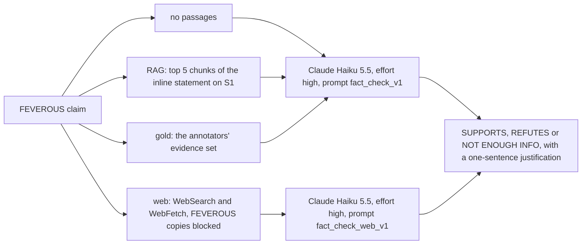

# The LLM fact-checker extension

Every number below comes from [results/llm/](../results/llm/), written by `scripts/llm_results.py`
([LLM_RESULTS.md](../results/llm/LLM_RESULTS.md) has every table, `llm_results.json` every value).

## 1. The question

Does a small model, Claude Haiku 5.5, get better at fact-checking with RAG, the top 5 chunks of
one SQL statement? And does RAG help more than letting the model search the web, as a person
would? Retrieval quality itself is covered by the database part ([EVALUATION.md](EVALUATION.md)).

- **RAG helps a lot, almost as much as the gold evidence.** It lifts Haiku from 45.2% to 70.9% of
  the 3,000 claims right; with the annotators' own evidence Haiku gets 72.9% (section 3).
- **RAG is ahead of web search: clearly on all claims, narrowly on the supported and refuted
  ones,** by 9.6 and 1.7 points (sections 3 and 5).
- **NOT ENOUGH INFO is the hardest label, partly because the label is weak.** With passages Haiku
  often picks a side on these claims, and on 16 of 40 audited RAG cases the label itself looked
  doubtful (section 4).

## 2. The setup

The same 3,000 claims ([data/scaled/claims_3000.jsonl](../data/scaled/claims_3000.jsonl): 1,000
per label, 700 of each on one page and 300 needing two or more) were judged four ways:



- **The model and the route.** `claude-haiku-5-5` at effort high, through the Claude Code CLI
  (2.1.322) on a Claude subscription, five calls at a time, one call per claim and condition
  (`wikilense/llm/runner.py`). The answer is forced into a JSON schema with two fields, `label`
  (one of the three labels) and `justification`; only the label is scored.
- **The prompt** of the three passage conditions,
  [`fact_check_v1/system.txt`](../wikilense/llm/prompts/fact_check_v1/system.txt), word for word:

  ```text
  Label the CLAIM SUPPORTS, REFUTES or NOT ENOUGH INFO as of December 2020, the date of the benchmark's Wikipedia snapshot, so later events do not count.

  When EVIDENCE is given, start from it: numbered Wikipedia passages retrieved for this claim, so some may be off-topic and a claim may need several together. Add your own knowledge where the passages fall short.

  - SUPPORTS: every part of the claim is confirmed.
  - REFUTES: at least one part is contradicted.
  - NOT ENOUGH INFO: nothing is contradicted, but some part stays unconfirmed. A fact no source mentions is unconfirmed, not false; a guess would turn that gap into a wrong label. A claim more specific than its source (a month where the source gives only a year) is unconfirmed too.

  Answer with one StructuredOutput call: "result" holds "label" (exactly one of the three) and "justification" (one sentence, at most 30 words: the deciding fact and the passages or sources used, such as [2]). No other text.
  ```

  The user turn is `EVIDENCE:` followed by the numbered passages, then `CLAIM:` and the claim;
  without passages it reads `EVIDENCE: (none given)`. The web prompt,
  [`fact_check_web_v1/system.txt`](../wikilense/llm/prompts/fact_check_web_v1/system.txt), replaces
  the second paragraph with one that lets the model search the web and open pages; its user turn
  is the claim alone.
- **Gold is a reference point, not a ceiling.** The prompt lets the model add its own knowledge
  where the passages fall short, because real retrieval will not always find the answer, and gold
  gets the same prompt: "gold" means the annotators' evidence plus the model's own knowledge.
- **The passages** of RAG come from the `inline` statement (the joined statement that
  `wikilense query` runs) on S1, 132,359 chunks, with k = 5 and `mhnsw_ef_search` 100, each chunk
  headed by its page title and section path. Retrieval was cached once per claim, so every run
  saw the same passages.
- **What the web condition blocks.** Claude Code's WebSearch and WebFetch tools are allowed, but
  WebFetch may not open the hosts in
  [`wikilense/llm/web_deny_hosts.txt`](../wikilense/llm/web_deny_hosts.txt): fever.ai, zenodo.org,
  github.com and its content hosts, huggingface.co and hf.co, kaggle.com and paperswithcode.com,
  with their subdomains. FEVEROUS's claims and labels are published there, and reading the answer
  key would not be fact-checking.
- **What is tested** is open-world fact-checking: the truth is not limited to Wikipedia.
  Fact-checking only against your own data, where the verdict must come from the passages alone,
  is further work.

## 3. Three-class results

Accuracy is the share of claims whose answer equals the FEVEROUS label. A label's recall is the
share of its 1,000 claims answered with that label; macro F1 is the mean of the three labels' F1,
a score that combines recall with precision, the share of the answers with that label that were
right. The ranges are 95% intervals (Wilson for accuracy, a bootstrap for macro F1).

| condition | accuracy (3,000 claims) | macro F1 | recall SUPPORTS / REFUTES / NOT ENOUGH INFO | NOT ENOUGH INFO answers, right |
|---|---|---|---|---|
| no passages | 45.2% (43.4 to 47.0) | 44.7 (42.9 to 46.5) | 30.5 / 40.0 / 65.1 | 1,765, 36.9% right |
| web search | 61.3% (59.5 to 63.0) | 56.8 (55.1 to 58.5) | 80.0 / 83.8 / 20.1 | 308, 65.3% right |
| RAG | 70.9% (69.2 to 72.5) | 69.6 (68.0 to 71.2) | 85.0 / 82.2 / 45.5 | 606, 75.1% right |
| gold | 72.9% (71.2 to 74.4) | 72.1 (70.5 to 73.7) | 85.7 / 80.0 / 52.9 | 755, 70.1% right |

**How the comparisons are worded.** Two conditions are "level" where the 95% interval of their
paired difference, compared claim by claim, includes zero; otherwise one is "ahead by X points",
with the interval in the text or in [LLM_RESULTS.md](../results/llm/LLM_RESULTS.md).

**RAG is clearly ahead of web search and close to gold: it recovers 92.9% of what the gold
evidence adds over no passages** (771 more right claims for RAG, 830 for gold).

| pair | difference, points | 95% interval |
|---|---|---|
| RAG ahead of web search | 9.6 | 8.0 to 11.2 |
| gold ahead of RAG | 2.0 | 0.7 to 3.3 |

Confusion matrices (rows: the FEVEROUS label; each cell: answered SUPPORTS / REFUTES / NOT ENOUGH
INFO, of 1,000 claims):

| label | no passages | web search | RAG | gold |
|---|---|---|---|---|
| SUPPORTS | 305 / 85 / 610 | 800 / 148 / 52 | 850 / 99 / 51 | 857 / 80 / 63 |
| REFUTES | 96 / 400 / 504 | 107 / 838 / 55 | 78 / 822 / 100 | 37 / 800 / 163 |
| NOT ENOUGH INFO | 186 / 163 / 651 | 411 / 388 / 201 | 254 / 291 / 455 | 226 / 245 / 529 |

The six groups (accuracy):

| group | claims | no passages | web search | RAG | gold |
|---|---|---|---|---|---|
| SUPPORTS, one article | 700 | 27.7% | 80.3% | 84.7% | 85.1% |
| SUPPORTS, two or more | 300 | 37.0% | 79.3% | 85.7% | 87.0% |
| REFUTES, one article | 700 | 39.3% | 88.3% | 86.1% | 82.7% |
| REFUTES, two or more | 300 | 41.7% | 73.3% | 73.0% | 73.7% |
| NOT ENOUGH INFO, one article | 700 | 67.6% | 20.3% | 47.4% | 55.3% |
| NOT ENOUGH INFO, two or more | 300 | 59.3% | 19.7% | 41.0% | 47.3% |

What it means:

- **Without passages Haiku hedges.** It answers NOT ENOUGH INFO on 1,765 of the 3,000 claims and is
  right on 36.9% of them, close to the 33.3% that chance gives on this balanced set, so NOT ENOUGH INFO
  is the label it recalls best there. This is an interpretation; the cause was not tested.
- **With passages or the web it picks a side, and NOT ENOUGH INFO becomes its worst label.** On
  the NOT ENOUGH INFO claims it picks a side 79.9% of the time with web search, 54.5% with RAG and
  47.1% even with gold; section 4 asks how many of those answers are really wrong.
- **Most of web search's gap to RAG is on these claims.** Web search gets 201 of the 1,000 right,
  RAG 455.
- **Refuted claims that need two or more articles are the hardest supported or refuted group:**
  web search, RAG and gold all stop at 73.0% to 73.7% (section 8).

**On FEVEROUS's own mix, where NOT ENOUGH INFO is rare, web search comes close to RAG, and RAG and
gold are level.** A third of our claims are NOT ENOUGH INFO, against 3.5% of FEVEROUS's. Weighting
each of the six groups by its share of all FEVEROUS train and dev claims, as the database part
does for recall ([EVALUATION.md](EVALUATION.md#reweighted-to-feverouss-mix),
[breakdown.json](../results/scaled/breakdown/breakdown.json)), gives:

| | no passages | web search | RAG | gold |
|---|---|---|---|---|
| accuracy, FEVEROUS's mix | 34.9% | 80.9% | 83.8% | 83.2% |

RAG is ahead of web search by 2.9 points (1.3 to 4.5), and RAG and gold are level (0.6, −0.7 to
2.0). Weights from only the claims with a text-only evidence set give nearly the same figures
([LLM_RESULTS.md](../results/llm/LLM_RESULTS.md)).

## 4. Why NOT ENOUGH INFO is a weak label here

FEVEROUS's annotators worked under rules that our prompt does not share (Aly et al., 2021,
[arXiv 2106.05707v3](https://arxiv.org/abs/2106.05707), appendix 7.10.1, the claim-verification
guidelines, and section 3.1.2):

- "However, an entire annotation for a single claim should not surpass 10 Minutes. If it does,
  keep the already annotated evidence and submit it with the verdict NotEnoughInformation."
- "If you have doubt regarding your assessment go with NEI, e.g. … it is NEI."
- "You must apply common-sense reasoning to the evidence you read but avoid applying your own
  (world) knowledge." The next sentences make one exception: "very general world knowledge"
  that "cannot be found on Wikipedia" may be used.
- A claim is NOT ENOUGH INFO "if not enough information can be found on Wikipedia to arrive at one
  of the two other verdicts".

So the label means "the annotator did not settle it from Wikipedia under these rules", not "the
answer does not exist". A model that is allowed outside knowledge can be marked wrong for a
correct verdict, when it finds the answer outside Wikipedia or finds what the annotator missed.

**The audit: about 4 in 10 of the reviewed gold and RAG "errors" may be right answers under a
doubtful label.** On some claims labelled NOT ENOUGH INFO, Haiku answered SUPPORTS or REFUTES,
which counts as wrong. Claude Opus 5.5 agents reviewed 100 such answers, drawn at random with a
fixed seed, and named the main reason for each. A doubtful label means that the text Haiku saw
does settle the claim, the way Haiku answered.

| condition | cases reviewed | main reason a doubtful label |
|---|---|---|
| gold | 40 | 16 |
| RAG | 40 | 16 |
| no passages | 20 | 4, judged from the annotators' evidence |

Two agents rated each case without seeing each other's ratings and agreed on the main reason in
94 of 100; a third settled those 6 and 3 more where the two disagreed on whether the text settles
the claim. This is a sample, not a count over all claims, and no person has checked the ratings.

## 5. The supported and refuted claims

**Why NOT ENOUGH INFO is dropped here.** Because of the label problem above, the comparison
between conditions uses the 2,000 claims whose label is SUPPORTS or REFUTES. The annotators found
evidence that settles these claims, so a NOT ENOUGH INFO answer counts as wrong, and no claim is
dropped because of the model's answer. This choice was made after seeing the results. It is the
cautious one for RAG: its lead over web search shrinks from 9.6 points on three classes to 1.7
points here.

**Here web search, RAG and gold are within 1.7 points of each other, and all three are 46.7 to
48.4 points above no passages.**

| condition | accuracy (2,000 claims) | picked a side | right when it picked a side |
|---|---|---|---|
| no passages | 35.3% (33.2 to 37.4) | 44.3% (886) | 79.6% (76.8 to 82.1) |
| web search | 81.9% (80.2 to 83.5) | 94.7% (1,893) | 86.5% (84.9 to 88.0) |
| RAG | 83.6% (81.9 to 85.2) | 92.5% (1,849) | 90.4% (89.0 to 91.7) |
| gold | 82.9% (81.1 to 84.4) | 88.7% (1,774) | 93.4% (92.2 to 94.5) |

- **Of web search, RAG and gold, the one that picks a side most often is right least often when it
  does.** Web search picks a side on 94.7% and is right on 86.5% of those; gold 88.7% and 93.4%.
- **Grading only the answers that pick a side would reward hedging:** no passages would score
  79.6%.

Claim by claim, on the same 2,000 claims (the intervals are not corrected for six comparisons):

| pair | only the first right | only the second right | difference, points | 95% interval |
|---|---|---|---|---|
| RAG vs web search | 145 | 111 | 1.7 | 0.1 to 3.3 |
| RAG vs gold | 102 | 87 | 0.8 | −0.6 to 2.1 |
| gold vs web search | 161 | 142 | 1.0 | −0.8 to 2.7 |
| RAG vs no passages | 998 | 31 | 48.4 | 46.0 to 50.7 |
| gold vs no passages | 989 | 37 | 47.6 | 45.3 to 49.9 |
| web search vs no passages | 976 | 43 | 46.7 | 44.3 to 49.0 |

- **Of web search, RAG and gold, only RAG against web search is larger than chance, and only
  just:** 1.7 points, a little above two rerun standard deviations of a difference (1.3, the
  spread between reruns of the same claims; section 7). RAG and gold are level.


## 6. F1 per label



Only the 2,000 supported and refuted claims count here. For each label, recall is the share of its
1,000 claims that got that label as the answer, and precision the share of the answers with that
label that were right; F1 combines the two. A "not enough information" answer lowers recall and
counts toward neither label's precision.

| condition | supported: precision / recall / F1 | refuted: precision / recall / F1 |
|---|---|---|
| web search | 88.2 / 80.0 / 83.9 | 85.0 / 83.8 / 84.4 |
| RAG | 91.6 / 85.0 / 88.2 | 89.3 / 82.2 / 85.6 |
| gold | 95.9 / 85.7 / 90.5 | 90.9 / 80.0 / 85.1 |

What it means:

- **On refuted claims web search, RAG and gold are level.** No paired difference in F1 is larger
  than chance.
- **On supported claims gold is best, then RAG, then web search.** RAG is ahead of web search by
  4.3 F1 points (2.8 to 5.9) and gold ahead of RAG by 2.3 (1.0 to 3.6).
- **Web search's weakness is calling refuted claims "supported".** It did that for 107 of the
  1,000 refuted claims, against 78 for RAG and 37 for gold, and each such answer lowers its
  precision on supported claims. RAG also finds more of the supported claims (recall 85.0 against
  80.0), so it is ahead on both counts. Gold's edge over RAG is precision alone: its recall is
  nearly the same.
- **RAG's small lead in accuracy (1.7 points) comes from the supported claims.** RAG gets 850 of
  them right against web search's 800; on the refuted claims web search is ahead, 838 against 822.

Intervals are by paired bootstrap (10,000 resamples, seed 20261121);
[LLM_RESULTS.md, section 2](../results/llm/LLM_RESULTS.md#precision-recall-and-f1-per-label) has
every one, and the no-passages row.

## 7. Run-to-run variance

The same model can give a different answer to the same prompt from one run to the next. To
measure how much, every condition ran twice more (r1 and r2) on 450 of the claims: 150 per label,
105 of each on one article and 45 needing two or more, the first claims of each of the six groups
when ordered by the SHA-256 of `repeat450-2026-11-19:<claim id>`. The repeats used the settings,
prompts and CLI binary (2.1.322) of the original runs. RAG read the same cached passages, and all
3,600 user turns of the repeats are byte for byte those of the original runs (compared by
`user_text_sha256`).

**How to read the table.** On these claims each condition has three runs: the original and the
repeats r1 and r2. The accuracy column gives each run's accuracy. The last column compares the
runs two at a time and gives the share of claims that one run of the pair got right and the other
got wrong, in either direction. Without passages, for example, 10.9% of the 450 claims were right
in the original run and wrong in r1, or the other way round; between r1 and r2 it was 8.4%. The
"300 supported/refuted" rows count only the sample's supported and refuted claims.

| condition | claims | accuracy: original / r1 / r2 | switched between right and wrong: original vs r1 / original vs r2 / r1 vs r2 |
|---|---|---|---|
| no passages | 450 | 48.0 / 44.7 / 46.0% | 10.9 / 10.0 / 8.4% |
| no passages | 300 supported/refuted | 37.0 / 32.7 / 34.3% | 11.0 / 10.7 / 6.3% |
| web search | 450 | 61.6 / 62.7 / 61.8% | 7.8 / 8.7 / 8.9% |
| web search | 300 supported/refuted | 79.0 / 81.3 / 80.7% | 5.7 / 7.0 / 8.0% |
| RAG | 450 | 69.6 / 69.1 / 70.7% | 4.4 / 3.3 / 5.6% |
| RAG | 300 supported/refuted | 83.0 / 82.0 / 83.7% | 3.7 / 2.0 / 5.0% |
| gold | 450 | 72.0 / 72.4 / 72.9% | 8.4 / 5.8 / 7.1% |
| gold | 300 supported/refuted | 83.3 / 80.0 / 82.0% | 6.7 / 3.3 / 5.3% |

What the table shows:

- **RAG's answers are the most stable, those without passages the least.** Between two runs RAG
  changed its answer on 4.7% to 6.7% of the 450 claims, the model without passages on 11.6% to
  13.8%.
- **A changed answer is not always a switch.** An answer can change from one wrong label to
  another, for example a supported claim answered refuted in one run and not enough information in
  the next. Accuracy stays the same, so the table does not count it.
- **Accuracy moves much less than the switches,** because claims switch in both directions and
  most of it cancels out. Without passages 10.9% of the claims switched between the original and
  r1, yet accuracy fell by only 3.3 points.
- **r1 vs r2 shows how much two runs made the same way differ.** The original is compared against
  that below.

**Run-to-run chance is small: well under a point.** One rerun standard deviation is:

| what moves | 3,000 claims | 2,000 supported/refuted |
|---|---|---|
| one condition's accuracy | 0.2 to 0.4 points | 0.2 to 0.5 points |
| a difference between two conditions | 0.3 to 0.6 points | 0.3 to 0.7 points |

If a share f of the claims switches between right and wrong from one run to the next, an accuracy
over n claims varies between runs by about √(f / 2n), and a difference between two conditions by
√2 times that, with f from the table above.

**Nothing clearly changed between the original runs and the repeats.** If something had, the
original would differ from both repeats more than they differ from each other.

- **Web search, RAG and gold: no sign of a change.** The original disagrees with a repeat about as
  often as the two repeats disagree with each other. Of their 18 accuracy differences between two
  runs, only one is larger than chance (its 95% interval excludes zero): gold on the 300
  supported/refuted claims, original vs r1, 3.3 points. There r1 is the low run; the original is
  level with r2.
- **No passages: maybe, but the runs cannot tell.** Its original run scored highest, disagrees
  with the repeats more than they do with each other, and is ahead of r1 by more than chance,
  though level with r2. The repeats used the same CLI binary, so the CLI version is not the cause.
  Over all four conditions, 3 of the 16 differences between the original and a repeat are larger
  than chance and none of the 8 between the repeats are, but with 24 comparisons and no correction
  for that, chance cannot be ruled out.
- **Either way, no conclusion in this document changes.** No passages trails every other condition
  by 16.1 points or more on three classes and by 46.7 or more on the supported/refuted claims.

**Every gap between two conditions is larger than this noise, except two that are level anyway.**
Section 5 flags a gap smaller than two rerun standard deviations of a difference (the larger of
the two conditions' SDs over the three pairs of runs): 1.1 to 1.2 points on the 3,000 claims, 1.2
to 1.5 on the 2,000 supported/refuted ones. Every paired gap on three classes in section 3 is
above that; the reweighted figures there have no rerun SD of their own. The closest cases are on
the supported/refuted claims:

| comparison | gap, points | two rerun SDs | result |
|---|---|---|---|
| RAG against web search | 1.7 | 1.3 | above, but not by much |
| RAG against gold | 0.8 | 1.2 | below (the two are level anyway) |
| gold against web search | 1.0 | 1.3 | below (the two are level anyway) |

[LLM_RESULTS.md, section 5](../results/llm/LLM_RESULTS.md#5-run-to-run-variance-450-repeated-claims)
has every pair of runs, the SDs for both claim counts and every difference between runs with its
interval.

## 8. Where it fails

- **Claims that need two or more articles are harder, for the model as well as for the search.**
  On the refuted ones RAG drops 13.1 points and gold, which is handed the evidence, 9.0
  ([Multi-hop claims and RAG](#multi-hop-claims-and-rag) below).

**When the search misses the right article.** This is rare: 57 of the 3,000 claims got no passage
from an article that holds their evidence. How often RAG is right with and without such a passage:

| claims | the right article is among the passages | it is not |
|---|---|---|
| supported or refuted | 83.9% of 1,987 | 30.8% of 13 |
| all three labels | 71.2% of 2,943 | 57.9% of 57 |

What it means:

- **On supported and refuted claims a miss is costly.** Without the right article RAG mostly
  answers "not enough information", which is wrong for these claims.
- **The overall accuracy hides this.** Most misses (44 of 57) are NOT ENOUGH INFO claims, where
  "not enough information" is the right answer, so over all claims the drop looks small.
- **For claims that need several articles, finding one of them is as good as finding all.** RAG
  is right about as often either way (65.6% with every article among the passages, 67.6% without;
  from `per_claim.csv` and `retrieval_top5.csv` in `results/llm/`). The limit on these claims is
  the model combining the articles, not the search: given the gold evidence it drops on them too
  (above).

### Multi-hop claims and RAG

Only the supported and refuted claims count here, as in section 5, and each label weighs one half,
so that a group with more refuted claims does not look harder for that reason alone (the
one-article and two-or-more groups are balanced already; the tags are not).
[LLM_RESULTS.md, section 6](../results/llm/LLM_RESULTS.md#6-multi-hop-claims-supported-and-refuted-claims-equal-weight)
has every number with its 95% interval.

"Multi-hop" means two overlapping things: 600 of these claims need two or more articles (every
evidence set spans two or more), and 488 carry the Multi-hop Reasoning tag, which the annotator who
verified the claim chose as its main difficulty; 427 are both. Accuracy by the number of articles a
claim needs (drops in points; "level" where the 95% interval includes zero):

| condition | one article | two or more | drop | drop, supported claims | drop, refuted claims |
|---|---|---|---|---|---|
| web search | 84.3% | 76.3% | 8.0 | 1.0 (level) | 15.0 |
| RAG | 85.4% | 79.3% | 6.1 | −1.0 (level) | 13.1 |
| gold | 83.9% | 80.3% | 3.6 (only just level) | −1.9 (level) | 9.0 |

What it means:

- **A second article makes refuted claims harder, not supported ones.** RAG drops 6.1 points, all
  of it on the refuted claims; on supported claims it does as well as with one article. Web search
  and gold show the same pattern.
- **The model struggles with the second article too, so better search alone would not fix it.**
  Gold, which is handed the evidence, drops on the refuted claims as well, and RAG stays as close
  to gold on two-article claims as on one-article ones (level in both). Having every article among
  the passages did not help RAG either: on the two-article claims it is right on 78.3% when the
  passages hold them all and on 78.9% when they do not. Whether the passages held the evidence
  sentences was not measured; [EVALUATION.md](EVALUATION.md#feverouss-challenge-tags) has the
  search on its own per tag.
- **RAG still helps a lot.** Its lead over no passages shrinks from 51.9 points on one article to
  40.0 on two or more, but stays very large. Against web search it is level in both groups.

**The Multi-hop Reasoning tag adds nothing beyond the number of articles.** RAG is 6.0 points less
accurate on it than on Other, but within each group (one article, two or more) the two tags are
level. The overall gap comes from the mix: 427 of the tag's 488 claims need two or more articles,
against 123 of Other's 1,311.

| tag (supported + refuted claims), equal weight | no passages | web search | RAG | gold |
|---|---|---|---|---|
| Other (602 + 709) | 34.0% | 83.1% | 85.4% | 83.5% |
| Multi-hop Reasoning (319 + 169) | 38.7% | 77.8% | 79.4% | 81.4% |
| Entity Disambiguation (34 + 46) | 32.9% | 77.0% | 77.7% | 77.0% |
| Search terms not in claim (18 + 15) | 27.8% | 81.1% | 87.8% | 75.6% |
| Numerical Reasoning (6 + 51) | 27.0% | 72.1% | 83.8% | 86.8% |
| Combining Tables and Text (21 + 10) | 49.0% | 80.5% | 68.3% | 70.7% |

**Limits.** These numbers come from one run: the repeats hold only 90 supported/refuted claims on
two or more articles, too few for a rerun SD of their own. NOT ENOUGH INFO is left out by choice,
the tags were not balanced when the claims were picked, and the last four tags have fewer than 100
claims here, too few for conclusions.

## 9. The web condition

- **Web search mostly read Wikipedia itself:** 3,744 of its 4,265 page fetches opened
  en.wikipedia.org. Over the 3,000 claims it also ran 3,965 searches, answered 228 claims without
  any tool call, and had 4 fetches stopped by the deny list.
- **Flagged claims.** An audit of every call's searches, URLs and tool results flagged 35 claims
  that mention FEVEROUS, a host where its data is published, or a label next to the word
  "Verdict"; they are kept in the results.
- **Today's web against December 2020.** On 255 supported/refuted claims web search gave the
  opposite label (148 supported claims answered REFUTES, 107 refuted ones SUPPORTS). Some may be
  facts that changed after 2020 (web search answering for today, not for December 2020 as the
  prompt asks), some wrong FEVEROUS labels, and the rest the model's own errors. None was checked
  against the December 2020 page versions, so the size of each group is not known. All 255 count
  as wrong answers in the results above.

## 10. Cost and time

- **The database search is a tiny part of a RAG call: 1.4% of its time.** The `inline` statement
  on S1 takes 27.301 ms at the median and the claim embedding 6.07 ms, against 2.3 s for the median
  RAG call ([separate_index.json](../results/scaled/run1/s1/separate_index.json),
  [s1_full_run1.json](../results/scaled/eval/s1_full_run1.json)), both timed with the CPU capped
  at 50% and the GPU at 2,100 MHz. The 1.4% is for an embedding on the GPU; the RAG run embedded
  its claims on the CPU, which was not timed.
- **RAG also makes the model faster and cheaper: with the passages Haiku thinks less.**

  | condition | median seconds per claim | × RAG | median thinking tokens | prompt tokens, all claims |
  |---|---|---|---|---|
  | no passages | 4.2 | 1.8 | 636 | 5,069,111 |
  | web search | 18.2 | 7.8 | 2,405 | 165,580,936 |
  | RAG | 2.3 | 1.0 | 227 | 9,766,910 |
  | gold | 2.6 | 1.1 | 276 | 5,532,364 |
- **Web search used by far the most of the subscription.** A subscription allows a set amount of
  use per five-hour window. By its own readings, which cover the whole account, web search used
  0.60 of a window (summed over the three windows its run spanned), RAG 0.05, and the no-passage
  and gold run together (6,000 calls) 0.11.
- **These are observed medians, not a controlled timing.** The calls went through the
  subscription to Anthropic's servers, five at a time, so their times depend on server load and
  the network. Only the database times are controlled measurements.

## 11. Contamination

**Contamination limits how far these numbers carry over to new claims, but it is not a measured
effect.** A direct memorization probe, such as asking the model to complete claims from their first
half, is further work.

- **Why it matters here.** FEVEROUS was published in 2021, and its claims, labels and Wikipedia
  pages are public, so they may be in Haiku's training data, which is not published; Anthropic
  gives Haiku 5.5 a training data cutoff of June 2026
  ([models overview](https://platform.claude.com/docs/en/about-claude/models/overview)). This
  applies to all four conditions, because the same model judges in each.
- **Two things to keep apart.** Having seen the benchmark's claim and label pairs is
  contamination. Knowing the Wikipedia facts is world knowledge, which the prompt allows.
- **The runs give little sign of memorized labels, but cannot rule them out.** Without passages
  Haiku gets only 45.2% right (35.3% on the supported/refuted claims), and 1,763 of its 1,765 NOT
  ENOUGH INFO justifications contain the words "no evidence". When it does pick a side without
  passages it is right 79.6% of the time, which could be world knowledge or memory; the runs cannot
  tell the two apart.
- **The web condition** has the most direct risk, copies of FEVEROUS online. Those hosts were
  blocked, and the 35 flagged claims (section 9) are kept.

## 12. Limitations

- One model, Claude Haiku 5.5, at one effort.
- One prompt per condition, not tuned.
- The time gap: the labels describe Wikipedia in December 2020; the prompt asks for that date, but
  the web shows today's pages. How many of web search's 255 opposite answers come from it was not
  checked (section 9).
- The NOT ENOUGH INFO label, made without outside knowledge (section 4). The audit of those
  answers was done by Claude agents only, and no person checked its ratings.
- Outside knowledge is allowed by design, so no condition tests reading alone.
- Contamination ([section 11](#11-contamination)).
- RAG was tested where retrieval is strongest: the embedding model was trained on Wikipedia and
  fine-tuned on FEVER ([the caveat](EVALUATION.md#the-embedding-models-training-data)).

## 13. How to rerun it

The runs used the subscription route: the Claude Code CLI, logged in to a Claude subscription,
with `--backend subscription` (the default). From the repository, with the CLI binary's path in
`--binary` and a folder for the run folders outside the repository:

```
.venv/bin/python scripts/llm_run.py --runs-root ../llm_runs --run-id haiku_high_fact_check_v1_noret_gold \
  --claims data/scaled/claims_3000.jsonl --claims-sha256 905cf1281d01e310702e820121864ac96ab0c07d5e857c24ad2d1314f532ab8a \
  --prompt fact_check_v1 --models haiku --effort high --full --binary <claude> --conditions no_retrieval,gold
.venv/bin/python scripts/llm_run.py --runs-root ../llm_runs --run-id haiku_high_fact_check_v1_retrieved \
  --claims data/scaled/claims_3000.jsonl --claims-sha256 905cf1281d01e310702e820121864ac96ab0c07d5e857c24ad2d1314f532ab8a \
  --prompt fact_check_v1 --models haiku --effort high --full --binary <claude> --conditions retrieved \
  --database wikilense_s1 --k 5
.venv/bin/python scripts/llm_run.py --runs-root ../llm_runs --run-id haiku_high_fact_check_web_v1_web \
  --claims data/scaled/claims_3000.jsonl --claims-sha256 905cf1281d01e310702e820121864ac96ab0c07d5e857c24ad2d1314f532ab8a \
  --prompt fact_check_web_v1 --models haiku --effort high --workers 5 --full --binary <claude>
.venv/bin/python scripts/llm_results.py table --runs-root ../llm_runs --claims data/scaled/claims_3000.jsonl
.venv/bin/python scripts/llm_results.py stats
python3 scripts/make_charts.py
```

The runner stops at 80% of the five-hour or the weekly usage window (`--stop-five-hour`,
`--stop-weekly`) and resumes when the same command is run again. RAG needs the S1 database
(`wikilense_s1`, [SETUP.md](SETUP.md#reproduce-the-scaled-run)); its passages are cached per claim
in the runs folder. `table` also takes `--nei-audit` and `--web-audit` with the audit files, whose
counts sections 4 and 9 cite; `stats` reads the files in `results/llm/` and `results/scaled/` and,
for the challenge tags of section 8, `data/scaled/claims_3000.jsonl`, after checking its SHA-256.
The repeats of section 7 ran the same three commands with `--claims` set to a file of the 450
picked lines of `claims_3000.jsonl`, unchanged, the six groups in alphabetical order of label and
`kind` and each group in the hash order (sha256
`9f044736dc67afe4e59d32fae53219fd9296481e480b4969807a65de735383fb`), and run ids ending in
`_rep450_r1` and `_rep450_r2`; `table` reads those folders when they exist.

**The API route** is for readers without a subscription: install the SDK by hand with
`.venv/bin/pip install -r requirements-llm.txt` (`make setup` does not), put `ANTHROPIC_API_KEY`
in `.env`, and add `--backend api --max-usd <limit>` to the commands above; the run stops when its
list-price spend reaches the limit. The reported runs did not use it.

## 14. On the web page

The web page (`make serve`) can run the RAG fact-check live on a statement the reader types. It is
off unless the server is set up for it ([SETUP.md](SETUP.md#turn-on-the-live-fact-check)). Until
then the page has one line saying how to turn it on, and no button.


What it sends is the RAG condition's request, unchanged:
- the system prompt, the user template and the schema of `fact_check_v1`, with Haiku at effort
  high;
- the statement and the first 5 passages of the reader's own search, which the server runs again,
  rendered by the runner's own code (`Runner.request`).

The server reads these settings from the RAG run's record in `results/llm/runs.json`. If the
prompt set's hash differs from the recorded one, the fact-check stays off and says why. One click
is one model call, with no retry and no web search.

What it shows:
- Haiku's verdict, next to "judged as of December 2020, the date of this Wikipedia copy", the date
  the prompt asks for.
- Haiku's reason, in full. Each passage number it cites, such as [2], links to that hit and
  highlights it. If it cites none, the page says "no passage cited: from the model's own
  knowledge". The reason is the model's own wording and can be wrong even when the verdict is
  right.
- How often that verdict was right in this experiment (RAG, all 3,000 claims): Supported 71.9%,
  Refuted 67.8%, Not enough info 75.1%. These are the per-label precisions in
  `results/llm/llm_results.json`. Next to them, the overall accuracy of 70.9% and the 83.6% on the
  supported and refuted claims (sections 3 and 5). The page reads every figure from that file
  when the server starts. If the file lacks a figure, the page says so and shows no number.

Where the figures stop applying:
- They were measured on benchmark claims whose evidence was in the database. A typed statement may
  have none there, especially on the 100-page demo, so expect lower. As the lower end, the page
  shows the accuracy on the 57 claims whose five passages held no gold page: 57.9% (33 of 57,
  interval 45.0 to 69.8; section 8).
- They were measured with the experiment's retrieval: S1, k 5, strategy `inline`,
  `mhnsw_ef_search` 100, no filter. When the reader's search differs (the demo database, another
  k, a filter, another strategy or another `ef_search`), the page says so.
- They were measured through the Claude Code CLI 2.1.322 on a subscription. With the API route
  the request is the same, but that route was never measured, and the page says so. With another
  CLI version the page names both versions.
- The button is for free text only. It is hidden while a benchmark claim is picked, because that
  claim's answer key is already on the page.

Three ways to run the fact-check on what the page retrieved:
1. Through a Claude subscription: the button, with `WIKILENSE_FACTCHECK=subscription` and the
   Claude Code CLI's own login.
2. Through the Anthropic API: the button, with `WIKILENSE_FACTCHECK=api` and the reader's own
   `ANTHROPIC_API_KEY`, billed per token.
3. Copy the prompt: a "Copy the prompt" box under every search, free text and picked claims
   alike, whatever the setting. It shows the request as one text with a "Copy" button, to paste
   into a chatbot. It needs no key and makes no call. `GET /api/prompt` returns the same text.

The copied text is the request above with one change. A chat window has no system field, so the
system prompt comes first, then a blank line, then the user turn exactly as the runner renders it.
The system prompt's last sentence (section 2) asks for a StructuredOutput call that a chat window
does not have; in the copy it reads:

> Answer with the label (exactly one of SUPPORTS, REFUTES or NOT ENOUGH INFO) and one sentence of justification, at most 30 words: the deciding fact and the passages or sources used, such as [2]. No other text.

The server checks that the first sentence occurs exactly once in `system.txt` and offers no copy
otherwise; the prompt set itself is never edited. With a picked claim, the claim's own text
follows `CLAIM:`, and the box says that the answer key is on the page, so the chatbot's label can
be compared with it.

The box shows no reliability figures: they were measured with Haiku, through the experiment's
settings and its tool call, and do not cover another chatbot's answer to the pasted text.
